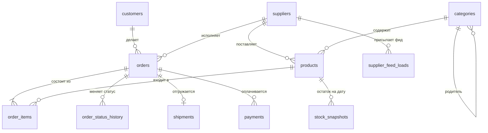

# Стенд: база маркетплейса

Все задачи практикума решаются на одной учебной базе — маркетплейсе, где покупатели заказывают товары у сорока поставщиков. Поставщики подключены по-разному: одни по API, другие присылают файлы по SFTP, третьих ведут вручную. Период данных — с 1 апреля по 30 сентября 2025 года; «сейчас» для этой базы — 1 октября 2025 года, 00:00 UTC. Исключение, как в жизни: журналы статусов и платежей догружались позже, поэтому в них есть события до 3 октября — отмены и возвраты по заказам сентября.

Данные синтетические, но **намеренно грязные**, как в жизни: в них есть дубли, пропуски, расхождения между источниками и следы сбоев интеграций. Находить их — часть практики. Поэтому не заглядывайте в `init/02-data.sql` до конца практикума: там в комментариях перечислены все заложенные дефекты. Это ваш ключ ответов.

Генерация воспроизводима: у всех, кто поднимет стенд, получатся одни и те же данные. Цифры в уроках сняты с этого стенда; если у вас расходятся последние знаки — это нормально, важен порядок величин и вывод.

## Запуск

Нужен Docker Desktop. Из папки `00c-sql-practicum/lab`:

```bash
docker compose up -d
docker compose logs -f db     # дождаться "database system is ready to accept connections"
```

Первый старт занимает около минуты. Подключение:

```bash
docker compose exec db psql -U study market
```

Или любым клиентом (DBeaver, DataGrip, VS Code): `localhost:55433`, база `market`, пользователь и пароль `study`. Порт отличается от стенда блока 2 (`55432`), поэтому оба стенда можно держать запущенными одновременно.

Все времена в базе — `timestamptz`, сессия по умолчанию работает в UTC. В уроке В.5 мы будем это менять осознанно.

## Схема



| Таблица | Строк | Что в ней |
|---|---|---|
| `customers` | 20 000 | Покупатели: email, сегмент (`B2B`, `B2C`), регион, дата регистрации |
| `suppliers` | 40 | Поставщики: тип интеграции (`api`, `sftp`, `manual`), срок доставки по договору `sla_days`, признак активности |
| `categories` | 85 | Дерево категорий: корень → подкатегория → раздел (`parent_id`) |
| `products` | 5 000 | Товары: артикул `sku`, категория, поставщик, цена |
| `orders` | ~150 000 | Заказ покупателя у одного поставщика: канал, текущий статус, сумма, время создания, обещанная дата доставки `promised_at` |
| `order_items` | ~290 000 | Позиции заказа: товар, количество, цена |
| `order_status_history` | ~580 000 | Журнал смены статусов: `NEW → PAID → SHIPPED → DELIVERED` или `CANCELLED`; кто записал событие — `marketplace` или `supplier`. Первичного ключа нет, как у многих журналов |
| `shipments` | ~136 000 | Отгрузка: когда передано в доставку, когда доставлено |
| `payments` | ~150 000 | Платежи от платёжного сервиса: `SUCCESS` и возвраты `REFUND` (с минусом), идентификатор платежа у провайдера |
| `supplier_feed_loads` | ~7 000 | Журнал ежедневных загрузок фидов поставщиков: когда, сколько строк, статус |
| `stock_snapshots` | ~73 000 | Остаток на конец дня по 400 товарам |
| `report_daily_revenue` | 183 | Витрина BI, по которой строится отчёт руководству: заказы и выручка доставленных заказов по дням |

Ключевые бизнес-правила, которые понадобятся в задачах:

- Заказ **опоздал**, если доставлен позже `promised_at`. `promised_at` = время создания + `sla_days` поставщика.
- **Выручка** — сумма доставленных заказов. Финансы считают по платежам, BI — по витрине. Совпадать они не обязаны, и в уроке В.6 мы разберём почему.
- Покупатель **активирован**, если сделал первый заказ в течение 14 дней после регистрации.

## Сброс

```bash
docker compose down -v    # удалит том с данными
docker compose up -d      # создаст всё заново
```

## Без Docker

Подойдёт любой PostgreSQL 14+: создайте базу и выполните по очереди `init/01-schema.sql` и `init/02-data.sql` в сессии с часовым поясом UTC. Если PostgreSQL нет вообще, задачи уроков В.1–В.4 можно решать и в онлайн-песочницах, но для В.5–В.8 нужен полноценный стенд: там важны время, объёмы и планы запросов.
