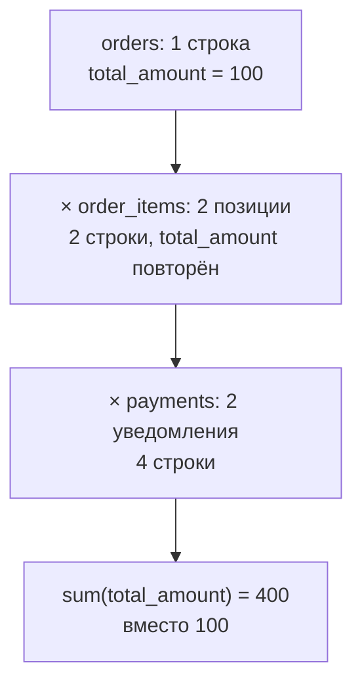

# В.2 Соединения без потерь и размножения: гранулярность, anti-join, ловушки NULL

## Зачем это аналитику

Отчёт «выручка по поставщикам» не сходится с финансами в два с половиной раза, список «доставлено без оплаты» пуст, хотя бухгалтерия видит долги, а запрос «категории без товаров» возвращает ноль строк. Во всех трёх случаях запрос синтаксически верен и выполняется без ошибок — сломано соединение. На собеседовании соединения проверяют почти всегда, и интервьюера интересует не `INNER` против `LEFT`, а умение предсказать, сколько строк получится после соединения и почему.

## Готовность к модулю

Модуль опирается на темы ниже. Если какая-то из них незнакома или её вопросы для самопроверки даются с трудом, начните с неё.

- [А.5 SQL для аналитика](../00a-foundations/a5-sql-basics.md)
- [В.1 Разведка данных](v1-data-recon.md)

## Куда ведёт

Тема подробнее раскрывается в модулях:

- [В.3 CTE и декомпозиция](v3-cte-decomposition.md)
- [В.6 Расследование расхождений](v6-reconciliation.md)

## Что понять

- [ ] **Гранулярность до и после соединения** — главная проверка: `count(*)` и `count(DISTINCT ключ)` до и после.
- [ ] **Размножение строк** (fan-out): почему `orders × order_items × payments` раздувает выручку и как это лечит **предагрегация** до соединения.
- [ ] Почему `SUM(DISTINCT ...)` — ложное исправление размножения.
- [ ] **Полусоединение** (semi-join): `EXISTS` против `JOIN` + `DISTINCT`.
- [ ] **Антисоединение** (anti-join): `LEFT JOIN ... IS NULL` и `NOT EXISTS`.
- [ ] Ловушка `NOT IN` с `NULL` в подзапросе и трёхзначная логика за ней.
- [ ] Условие правой таблицы `LEFT JOIN` в `ON` против `WHERE` на рабочем примере.
- [ ] `FULL OUTER JOIN` как инструмент сверки двух источников.
- [ ] Соединение не по ключу (по `lower(email)`) и самосоединение с интервалом времени.

## Урок

<!-- LESSON:START -->
Все примеры выполняются на [стенде](lab/README.md); запросы проверены на PostgreSQL 16.

### Главная проверка: сколько строк было и сколько стало

Модуль А.5 ввёл правило: соединение «один ко многим» повторяет строку родителя по числу детей. Практическое следствие — перед каждым соединением задавать два вопроса: какая гранулярность у результата и сохранилась ли гранулярность левой таблицы. Ответ проверяется тремя числами.

```sql
SELECT (SELECT count(*)
        FROM orders
        WHERE status = 'DELIVERED'
          AND created_at >= '2025-09-01' AND created_at < '2025-10-01') AS before,
       count(*)             AS after,
       count(DISTINCT o.id) AS distinct_orders
FROM orders o
JOIN payments p ON p.order_id = o.id
WHERE o.status = 'DELIVERED'
  AND o.created_at >= '2025-09-01' AND o.created_at < '2025-10-01';
```

```
 before | after | distinct_orders
--------+-------+-----------------
  33953 | 33980 |           33844
```

Три разных числа — две разные проблемы в одном соединении. `after > distinct_orders`: часть заказов размножилась (это повторные уведомления о платеже из [В.1](v1-data-recon.md)). `distinct_orders < before`: часть заказов потерялась — у них нет платежа, и внутреннее соединение их выбросило. Если бы проверили только `before` против `after`, увидели бы разницу в 27 строк и решили, что всё почти в порядке: размножение и потери частично гасят друг друга.

Правило: после соединения `count(*)` должен совпадать с `count(DISTINCT ключ_левой_таблицы)`, если вы хотите сохранить её гранулярность, и `count(DISTINCT ключ)` должен совпадать с числом строк до соединения, если никто не должен потеряться.

### Размножение: выручка в два с половиной раза больше

Задача: выручка доставленных заказов, созданных в сентябре. Справочное значение — по одной таблице, без соединений:

```sql
SELECT count(*) AS orders_cnt, sum(total_amount) AS revenue
FROM orders
WHERE status = 'DELIVERED'
  AND created_at >= '2025-09-01' AND created_at < '2025-10-01';
```

```
 orders_cnt |    revenue
------------+---------------
      33953 | 1364700845.68
```

Теперь запрос, который «заодно» хочет показать сумму по позициям и сумму оплат:

```sql
SELECT count(*)              AS rows_cnt,
       count(DISTINCT o.id)  AS orders_cnt,
       sum(o.total_amount)   AS revenue_orders,
       sum(i.qty * i.price)  AS revenue_items,
       sum(p.amount)         AS paid
FROM orders o
JOIN order_items i ON i.order_id = o.id
JOIN payments p    ON p.order_id = o.id
WHERE o.status = 'DELIVERED'
  AND o.created_at >= '2025-09-01' AND o.created_at < '2025-10-01';
```

```
 rows_cnt | orders_cnt | revenue_orders | revenue_items |     paid
----------+------------+----------------+---------------+---------------
    65625 |      33844 |  3486296433.44 | 1365907959.65 | 3486296281.94
```

`revenue_orders` и `paid` завышены в 2,55 раза: в заказе в среднем почти две позиции, `total_amount` заказа повторился в каждой, а у крупных заказов позиций больше, поэтому сумма раздувается сильнее, чем число строк. А `revenue_items` выглядит правдоподобно — сумма позиций на уровне позиций и должна суммироваться. Это и есть коварство: одна колонка результата верна, соседняя нет, и по виду таблицы не скажешь, какая.



**Лечение — предагрегация**: каждую дочернюю таблицу сначала свернуть до гранулярности родителя («одна строка на заказ»), и только потом соединять. Соединение «один к одному» ничего не размножает.

```sql
WITH sept_orders AS (
    SELECT id, supplier_id, total_amount
    FROM orders
    WHERE status = 'DELIVERED'
      AND created_at >= '2025-09-01' AND created_at < '2025-10-01'
),
items_by_order AS (
    SELECT order_id, sum(qty * price) AS items_amount
    FROM order_items
    WHERE order_id IN (SELECT id FROM sept_orders)
    GROUP BY order_id
),
paid_by_order AS (
    SELECT order_id, sum(amount) AS paid_amount
    FROM payments
    WHERE order_id IN (SELECT id FROM sept_orders)
    GROUP BY order_id
)
SELECT count(*)            AS orders_cnt,
       sum(o.total_amount) AS revenue_orders,
       sum(i.items_amount) AS revenue_items,
       sum(p.paid_amount)  AS paid
FROM sept_orders o
JOIN items_by_order i     ON i.order_id = o.id
LEFT JOIN paid_by_order p ON p.order_id = o.id;
```

```
 orders_cnt | revenue_orders | revenue_items |     paid
------------+----------------+---------------+---------------
      33953 |  1364700845.68 | 1365465919.73 | 1365026420.57
```

Число заказов и выручка совпали со справочными. Платежи присоединены через `LEFT JOIN`, чтобы заказы без оплаты не выпали. Три суммы между собой не равны — и это уже не ошибка запроса, а находки в данных: скидка, не отражённая в позициях, недоплаты и повторные уведомления. Их расследование — тема [В.6](v6-reconciliation.md).

**Ложное исправление — `SUM(DISTINCT ...)`.** Первое, что приходит в голову: раз значения повторились, сложить только разные.

```sql
SELECT sum(DISTINCT o.total_amount) AS sum_distinct
FROM orders o
JOIN order_items i ON i.order_id = o.id
JOIN payments p    ON p.order_id = o.id
WHERE o.status = 'DELIVERED'
  AND o.created_at >= '2025-09-01' AND o.created_at < '2025-10-01';
-- 1306014454.78
```

Теперь занижение на 4%: `DISTINCT` убирает повторы значений, а не повторы заказов, и два разных заказа на одинаковую сумму складываются один раз. В сентябре у 34 тысяч доставленных заказов всего около 29 тысяч различных сумм. `count(DISTINCT o.id)` корректен — `id` уникален; `sum(DISTINCT amount)` — нет.

### Размножение без «очевидной» причины

Соединение `orders JOIN payments` выглядит как «один к одному»: у заказа один платёж. Но разведка в [В.1](v1-data-recon.md) показала, что гранулярность `payments` — одно уведомление провайдера, а не один заказ. Если выручку считать по `sum(o.total_amount)` из такого соединения, 136 сентябрьских заказов с двойным уведомлением добавят около 4,9 млн, а 109 заказов без платежа отнимут около 4,5 млн. Итог отличается от справочного всего на 0,02% — такое расхождение на отчёте никто не заметит, но в нём сидят две настоящие проблемы. Соединение не бывает «простым», пока гранулярность обеих сторон не проверена.

### Полусоединение: «есть хотя бы один»

Вопрос «сколько покупателей получили доставку в сентябре» — это не соединение, а фильтр: покупатель попадает в ответ, если **существует** подходящий заказ. Такая операция называется полусоединением (semi-join). Ошибка — писать её обычным `JOIN`:

```sql
SELECT c.segment, count(*) AS customers
FROM customers c
JOIN orders o ON o.customer_id = c.id
WHERE o.status = 'DELIVERED'
  AND o.created_at >= '2025-09-01' AND o.created_at < '2025-10-01'
GROUP BY c.segment;
```

```
 segment | customers
---------+-----------
 B2B     |     13569
 B2C     |     20384
```

Это число заказов, а не покупателей. Исправить можно `count(DISTINCT c.id)`, но честнее выразить намерение:

```sql
SELECT c.segment, count(*) AS customers
FROM customers c
WHERE EXISTS (
    SELECT 1
    FROM orders o
    WHERE o.customer_id = c.id
      AND o.status = 'DELIVERED'
      AND o.created_at >= '2025-09-01' AND o.created_at < '2025-10-01'
)
GROUP BY c.segment;
```

```
 segment | customers
---------+-----------
 B2C     |      8037
 B2B     |      2743
```

`EXISTS` не размножает строки по построению: покупатель либо проходит фильтр, либо нет. PostgreSQL сам превращает его в эффективный план — в `EXPLAIN` видно `Hash Join` по заранее сгруппированным `customer_id`. `JOIN` + `DISTINCT` даёт тот же ответ, но сначала строит размноженный набор, а потом схлопывает его, и при добавлении в `SELECT` ещё одного столбца из `orders` `DISTINCT` молча перестаёт работать. `IN (SELECT customer_id FROM orders WHERE ...)` — третья эквивалентная форма, безопасная, пока речь об `IN`, а не `NOT IN`.

### Антисоединение: «нет ни одного»

Обратная задача — найти строки, у которых пары нет: доставленные заказы без платежа. Две стандартные формы, обе переносимы между СУБД:

```sql
-- форма 1: LEFT JOIN и проверка на отсутствие пары
SELECT count(*)
FROM orders o
LEFT JOIN payments p ON p.order_id = o.id
WHERE o.status = 'DELIVERED'
  AND p.order_id IS NULL;

-- форма 2: NOT EXISTS
SELECT count(*), sum(o.total_amount)
FROM orders o
WHERE o.status = 'DELIVERED'
  AND NOT EXISTS (SELECT 1 FROM payments p WHERE p.order_id = o.id);
```

```
 count |     sum
-------+-------------
   447 | 18276063.29
```

Почти 450 доставленных заказов на 18 млн рублей без единой записи о платеже. В первой форме `IS NULL` проверяют по столбцу правой таблицы, который не может быть `NULL` у существующей строки, — лучше всего по столбцу соединения (`p.order_id`). Проверка по столбцу, где `NULL` бывают и в данных, смешает «пары нет» с «пара есть, но поле пустое».

Ловушка первой формы — добавить условие на правую таблицу в `WHERE`. «Доставлены без *успешного* платежа»:

```sql
SELECT count(*)
FROM orders o
LEFT JOIN payments p ON p.order_id = o.id
WHERE o.status = 'DELIVERED'
  AND p.status = 'SUCCESS'
  AND p.order_id IS NULL;
-- 0
```

Ноль, и он выглядит как хорошая новость. Условия `p.status = 'SUCCESS'` и `p.order_id IS NULL` взаимоисключающие. Условие на правую таблицу переносится в `ON` (`LEFT JOIN payments p ON p.order_id = o.id AND p.status = 'SUCCESS'`) или внутрь `NOT EXISTS`. С `NOT EXISTS` такая ошибка невозможна, поэтому для антисоединения он предпочтительнее. По скорости формы почти равны, но с оговоркой: для `NOT EXISTS` и для `LEFT JOIN ... WHERE p.order_id IS NULL` PostgreSQL 16 строит антисоединение (на стенде — `Hash Anti Join`), а для проверки по первичному ключу `p.id IS NULL` — обычное внешнее соединение с фильтром после него. До версии 18 включительно (значит, и в PostgreSQL 17) планировщик распознаёт антисоединение, только когда `IS NULL` проверяет столбец, участвующий в условии соединения `ON`; в PostgreSQL 19 (осенью 2026 года — в стадии выпуска) он научился учитывать и ограничения `NOT NULL`, так что `p.id IS NULL` там тоже станет антисоединением. `NOT EXISTS` от версии не зависит.

### Ловушка NOT IN: пустой ответ из-за одного NULL

Задача: категории, в которых нет ни одного товара. Естественная запись:

```sql
SELECT count(*)
FROM categories c
WHERE c.id NOT IN (SELECT category_id FROM products);
-- 0
```

Ноль. Тот же вопрос через `NOT EXISTS`:

```sql
SELECT count(*)
FROM categories c
WHERE NOT EXISTS (SELECT 1 FROM products p WHERE p.category_id = c.id);
-- 25
```

25 категорий без товаров есть — это корневые категории и подкатегории, товары заводятся только в листьях дерева. Почему `NOT IN` их не видит? `x NOT IN (a, b, c)` по определению означает `x <> a AND x <> b AND x <> c`. У 2% товаров `category_id` пустой, и в списке есть `NULL`. Для категории 1 условие превращается в `1 <> 26 AND ... AND 1 <> NULL`. Последнее сравнение даёт «неизвестно», а `истина AND неизвестно` — тоже «неизвестно». `WHERE` пропускает только истину, и строка отбрасывается. Так для каждой категории.

```sql
SELECT 26 NOT IN (1, 2, NULL) AS with_null,
       26 NOT IN (1, 2)       AS clean,
       1  NOT IN (1, 2, NULL) AS present;
```

```
 with_null | clean | present
-----------+-------+---------
           | t     | f
```

Если значение найдено в списке, ответ — уверенная ложь. Если не найдено, но в списке есть `NULL`, — «неизвестно»: база не может исключить, что неизвестное значение и есть искомое. Защита: писать `NOT EXISTS`, либо добавлять `WHERE category_id IS NOT NULL` в подзапрос. Опасность в том, что сегодня столбец без `NULL`, и `NOT IN` работает, а завтра загрузка принесёт одну пустую строку, и отчёт тихо обнулится.

### LEFT JOIN: условие в ON или в WHERE

Механизм разобран в А.5; здесь — как он выглядит на объёме. Нужен список всех покупателей с числом доставленных в сентябре заказов, включая тех, у кого их нет:

```sql
SELECT count(*) AS rows_cnt, count(DISTINCT c.id) AS customers
FROM customers c
LEFT JOIN orders o ON o.customer_id = c.id
WHERE o.status = 'DELIVERED'
  AND o.created_at >= '2025-09-01' AND o.created_at < '2025-10-01';
```

```
 rows_cnt | customers
----------+-----------
    33953 |     10780
```

Из 20 тысяч покупателей осталось меньше 11 тысяч: `LEFT JOIN` стал внутренним. Перенос условий в `ON` возвращает всех, но строк станет больше, чем покупателей, — гранулярность снова не «покупатель». Правильная форма сочетает обе идеи урока: предагрегация и `LEFT JOIN`.

```sql
WITH sept AS (
    SELECT customer_id, count(*) AS delivered_cnt
    FROM orders
    WHERE status = 'DELIVERED'
      AND created_at >= '2025-09-01' AND created_at < '2025-10-01'
    GROUP BY customer_id
)
SELECT c.id, c.segment, coalesce(s.delivered_cnt, 0) AS delivered_cnt
FROM customers c
LEFT JOIN sept s ON s.customer_id = c.id
ORDER BY c.id;
```

20 тысяч строк, у 9 220 покупателей — ноль. Здесь `COALESCE(..., 0)` уместен: «не было доставленных заказов» и есть ноль.

### FULL OUTER JOIN: сверка двух источников

`FULL JOIN` оставляет строки обеих сторон, даже без пары. Это естественный инструмент сверки: число доставок по дням из `shipments` против витрины BI.

```sql
WITH bi AS (
    SELECT report_date, sum(orders_cnt) AS orders_cnt
    FROM report_daily_revenue
    GROUP BY report_date
),
fact AS (
    SELECT delivered_at::date AS report_date, count(*) AS orders_cnt
    FROM shipments
    WHERE delivered_at IS NOT NULL
    GROUP BY delivered_at::date
)
SELECT coalesce(f.report_date, b.report_date) AS report_date,
       f.orders_cnt AS fact_cnt,
       b.orders_cnt AS bi_cnt
FROM fact f
FULL JOIN bi b ON b.report_date = f.report_date
WHERE f.orders_cnt IS DISTINCT FROM b.orders_cnt
ORDER BY report_date;
```

```
 report_date | fact_cnt | bi_cnt
-------------+----------+--------
 2025-07-12  |      677 |
 2025-08-03  |      721 |   1442
```

Два дня из 183 расходятся: одного дня в витрине нет, другой учтён дважды. Обратите внимание на предагрегацию витрины: без `GROUP BY report_date` дубль 3 августа превратился бы в две строки по 721, каждая «совпала» бы с фактом, и расхождение исчезло бы из отчёта. `IS DISTINCT FROM` — стандартное сравнение, где `NULL` против числа даёт истину, а не «неизвестно». `FULL JOIN` тоже стандартный, но в MySQL его нет: там его эмулируют объединением `LEFT JOIN` и `RIGHT JOIN` через `UNION`. Методика сверки целиком — в [В.6](v6-reconciliation.md).

### Соединение не по ключу и самосоединение

Соединять можно по любому выражению, не только по внешнему ключу. Дубли аккаунтов, найденные в [В.1](v1-data-recon.md), удобно вывести парами через самосоединение (self-join) по нормализованному email:

```sql
SELECT a.id AS main_id, b.id AS dup_id, a.email, b.email AS dup_email
FROM customers a
JOIN customers b
  ON lower(a.email) = lower(b.email)
 AND a.id < b.id
ORDER BY a.id;
```

Условие `a.id < b.id` важно: без него каждая строка соединится сама с собой (20 тысяч лишних пар), а с `a.id <> b.id` каждая пара появится дважды — в обоих порядках. Соединение по выражению (`lower(email)`) не может использовать обычный индекс по `email`; на больших таблицах для этого создают индекс по выражению.

Самосоединение с интервалом времени находит события-близнецы — например, заказ, созданный повторно через несколько секунд. Это одна из задач практики.

### Чек-лист перед любым соединением

1. Какова гранулярность каждой стороны? Уникален ли ключ соединения справа?
2. Какой гранулярности должен быть результат? Если «как у левой», дочерние таблицы сначала агрегировать.
3. Нужен ли мне «каждый слева» (`LEFT`), «только с парой» (`INNER`), «есть ли пара» (`EXISTS`) или «нет пары» (`NOT EXISTS`)?
4. Где стоят условия на правую таблицу внешнего соединения: в `ON` или в `WHERE`, и что это меняет?
5. Есть ли `NULL` в столбцах соединения и в подзапросах `NOT IN`?
6. После выполнения: `count(*)`, `count(DISTINCT ключ)` и число строк до соединения.

### Типичные ошибки

- Суммировать столбец родителя после соединения с детьми и получать кратное завышение.
- «Лечить» размножение `SUM(DISTINCT ...)` и терять заказы с одинаковыми суммами.
- Считать соединение «один к одному», не проверив уникальность ключа справа.
- Сверять только `count(*)` до и после — размножение и потери гасят друг друга.
- Использовать `JOIN` там, где нужен `EXISTS`, и считать строки вместо объектов.
- Писать `NOT IN` по столбцу, где может появиться `NULL`.
- Ставить условие на правую таблицу `LEFT JOIN` в `WHERE` и получать пустой антисоединительный отчёт.
- Самосоединение без `a.id < b.id`: пары с самим собой и пары в обоих порядках.

### Как говорить об этом на собеседовании

Перед тем как писать соединение, скажите вслух гранулярность: «`order_items` — несколько строк на заказ, `payments` тоже может быть несколько — возвраты и повторы. Поэтому сначала сверну позиции и платежи до заказа, потом соединю». Это одна фраза, и она сразу отделяет вас от кандидатов, которые получат завышенную выручку.

На задачу «найти тех, у кого нет» отвечайте `NOT EXISTS` и объясняйте, почему не `NOT IN`: «если в подзапросе окажется `NULL`, `NOT IN` вернёт пустоту — трёхзначная логика». Если интервьюер просит `LEFT JOIN ... IS NULL`, назовите, по какому столбцу проверяете `IS NULL` и почему он не может быть пустым у реальной строки. Завершайте проверкой: «сверю `count(*)` с `count(DISTINCT order_id)`».

### Коротко

- Каждое соединение проверяют тремя числами: строк до, строк после, уникальных ключей после.
- Соединение с дочерней таблицей размножает строки родителя. Лечение — агрегировать детей до гранулярности родителя и только потом соединять. `SUM(DISTINCT)` не лечит.
- «Простое» соединение размножает строки, если ключ справа не уникален: двойные уведомления о платеже.
- Полусоединение — `EXISTS`, антисоединение — `NOT EXISTS` или `LEFT JOIN ... WHERE правый_ключ IS NULL`.
- `NOT IN` при `NULL` в подзапросе возвращает пустоту: сравнение с `NULL` даёт «неизвестно».
- Условие на правую таблицу `LEFT JOIN` в `WHERE` превращает соединение во внутреннее и ломает антисоединение.
- `FULL JOIN` с `IS DISTINCT FROM` — каркас сверки двух источников.
- Самосоединение требует условия порядка `a.id < b.id`.
<!-- LESSON:END -->

## Читать дальше

- Документация PostgreSQL: [соединения таблиц в FROM](https://www.postgresql.org/docs/current/queries-table-expressions.html#QUERIES-JOIN), [EXISTS, IN и NOT IN с подзапросами](https://www.postgresql.org/docs/current/functions-subquery.html), [IS DISTINCT FROM](https://www.postgresql.org/docs/current/functions-comparison.html).
- Алан Бьюли, «Изучаем SQL» — главы о соединениях и подзапросах.
- Джо Селко, «SQL for Smarties» — главы о внешних соединениях и о NULL в предикатах.
- Маркус Винанд, [use-the-index-luke.com](https://use-the-index-luke.com) — раздел о соединениях: как база выполняет nested loop, hash join и merge join.

## Практика

Задачи решаются на [стенде](lab/README.md). Сначала решите сами с таймером, потом сверяйтесь с разбором.

### Задача 1. Выручка по поставщикам: найти ошибку

Коллега прислал отчёт «выручка доставленных заказов по поставщикам за сентябрь» (по дате создания заказа). Финансы говорят, что цифры завышены. Найдите ошибку, объясните её и исправьте. Верните `supplier_id`, число заказов и выручку, отсортированные по выручке. Таймер: 10 минут.

```sql
SELECT o.supplier_id,
       count(*)            AS orders_cnt,
       sum(o.total_amount) AS revenue
FROM orders o
JOIN order_items i ON i.order_id = o.id
JOIN payments p    ON p.order_id = o.id
WHERE o.status = 'DELIVERED'
  AND o.created_at >= '2025-09-01' AND o.created_at < '2025-10-01'
GROUP BY o.supplier_id
ORDER BY revenue DESC;
```

<details markdown="1">
<summary>Решение и разбор</summary>

Запрос коллеги для лидера даёт 1 883 «заказа» и около 118 млн. Исправленный:

```sql
SELECT supplier_id,
       count(*)          AS orders_cnt,
       sum(total_amount) AS revenue
FROM orders
WHERE status = 'DELIVERED'
  AND created_at >= '2025-09-01' AND created_at < '2025-10-01'
GROUP BY supplier_id
ORDER BY revenue DESC;
```

```
 supplier_id | orders_cnt |   revenue
-------------+------------+-------------
          32 |        950 | 44589615.48
          20 |        916 | 42920969.35
          23 |        856 | 42018466.42
 ...
```

У каждого поставщика выручка была завышена в 2,4–2,7 раза, в сумме — в 2,55 раза. Причина: `total_amount` — атрибут заказа, а соединение с `order_items` повторило его столько раз, сколько позиций в заказе, `payments` — ещё раз для заказов с несколькими платежами. Заодно внутреннее соединение с `payments` выбросило доставленные заказы без оплаты, и `count(*)` считал строки, а не заказы.

Главный вывод: соединения были не нужны вовсе — все поля есть в `orders`. Если нужны суммы по позициям или оплатам рядом, их агрегируют до заказа в CTE и присоединяют `LEFT JOIN`, как в уроке. Порядок поставщиков почти не изменился — поэтому ошибку и не видно «на глаз»: рейтинг правдоподобен, абсолютные цифры нет.

</details>

### Задача 2. Доставленные без оплаты

Найдите доставленные заказы, по которым нет ни одного платежа. Верните количество и сумму по месяцам создания. Решите двумя способами — `NOT EXISTS` и `LEFT JOIN` — и убедитесь, что ответы совпадают. Есть ли у этих заказов что-то общее? Таймер: 10 минут.

<details markdown="1">
<summary>Решение и разбор</summary>

```sql
SELECT date_trunc('month', o.created_at)::date AS month,
       count(*)            AS unpaid_cnt,
       sum(o.total_amount) AS unpaid_amount
FROM orders o
WHERE o.status = 'DELIVERED'
  AND NOT EXISTS (SELECT 1 FROM payments p WHERE p.order_id = o.id)
GROUP BY date_trunc('month', o.created_at)
ORDER BY month;

SELECT count(*)
FROM orders o
LEFT JOIN payments p ON p.order_id = o.id
WHERE o.status = 'DELIVERED'
  AND p.order_id IS NULL;
```

```
   month    | unpaid_cnt | unpaid_amount
------------+------------+---------------
 2025-04-01 |         60 |    2191822.71
 2025-05-01 |         52 |    2606955.16
 ...
 2025-09-01 |        109 |    4549599.57
```

Всего 447 заказов на 18,3 млн, обе формы дают одно число. Рост по месяцам повторяет рост числа заказов — это постоянная доля, а не разовый сбой. Если посмотреть на `id % 300` этих заказов, у всех остаток 7: потери детерминированы, как бывает при ошибке в коде интеграции, а не при случайных сбоях сети. На реальных данных такой признак ищут по атрибутам: канал, поставщик, способ оплаты, версия приложения.

Проверьте и ловушку: добавьте в `LEFT JOIN`-форму условие `AND p.status = 'SUCCESS'` в `WHERE` — получится 0. Правильно — в `ON` или внутри `NOT EXISTS`.

</details>

### Задача 3. Разделы без товаров поставщика

Менеджер по ассортименту поставщика 10 спрашивает: в каких разделах (листовых категориях — тех, у которых нет дочерних) у поставщика нет ни одного товара? Решите через `NOT EXISTS`. Затем попробуйте `NOT IN (SELECT category_id FROM products WHERE supplier_id = 10)` и объясните разницу. Повторите для поставщика 31. Таймер: 12 минут.

<details markdown="1">
<summary>Решение и разбор</summary>

```sql
SELECT c.id, c.name
FROM categories c
WHERE NOT EXISTS (SELECT 1 FROM categories ch WHERE ch.parent_id = c.id)   -- лист
  AND NOT EXISTS (
      SELECT 1
      FROM products p
      WHERE p.category_id = c.id
        AND p.supplier_id = 10
  )
ORDER BY c.id;
```

Для поставщика 10 — 11 разделов из 60. Версия с `NOT IN` вернёт 0 строк: среди товаров поставщика 10 четверть сотни без категории (`category_id IS NULL`), и любой `x NOT IN (..., NULL)` даёт «неизвестно». Для поставщика 31 обе версии вернут 6 разделов — у его товаров категория заполнена всегда.

Это и есть главная опасность `NOT IN`: запрос правильный «на одних поставщиках» и молча пустой на других. Ответ ноль менеджер воспримет как «у нас полный ассортимент». Исправления: `NOT EXISTS` или `NOT IN (SELECT category_id ... WHERE category_id IS NOT NULL)`. Определение листа через `NOT EXISTS` по самой таблице категорий — тоже антисоединение, самосоединённое.

</details>

### Задача 4. Дубли аккаунтов по email

Выведите пары аккаунтов, у которых email совпадает без учёта регистра: `main_id`, `dup_id`, оба адреса и разницу в датах регистрации. Сколько таких пар и у скольких из них заказы есть на обоих аккаунтах? Таймер: 10 минут.

<details markdown="1">
<summary>Решение и разбор</summary>

```sql
SELECT a.id AS main_id, b.id AS dup_id, a.email, b.email AS dup_email,
       b.registered_at - a.registered_at AS gap
FROM customers a
JOIN customers b
  ON lower(a.email) = lower(b.email)
 AND a.id < b.id
ORDER BY a.id;

SELECT count(*) AS pairs,
       count(*) FILTER (WHERE EXISTS (SELECT 1 FROM orders o WHERE o.customer_id = a.id)
                          AND EXISTS (SELECT 1 FROM orders o WHERE o.customer_id = b.id)) AS both_have_orders
FROM customers a
JOIN customers b
  ON lower(a.email) = lower(b.email)
 AND a.id < b.id;
```

```
 main_id | dup_id |       email        |     dup_email      |  gap
---------+--------+--------------------+--------------------+--------
       1 |  19851 | user1@mail.example | User1@mail.example | 3 days
       2 |  19852 | user2@mail.example | User2@mail.example | 3 days
 ...
```

150 пар, во всех второй аккаунт заведён через три дня с заглавной первой буквой, и в 80 парах заказы есть на обоих аккаунтах. Значит, метрики «число покупателей», «заказов на покупателя» и «повторные покупки» искажены: один человек считается двумя, а его второй заказ — первым заказом нового клиента.

Проверка условия соединения: с `a.id <> b.id` пар будет 300 (каждая дважды), без условия — 20 300 (каждый аккаунт ещё и сам с собой). Требование для постановки — уникальность email без учёта регистра при регистрации (в PostgreSQL — уникальный индекс по `lower(email)`).

</details>

### Задача 5. Пары «двойного клика»

Найдите пары заказов: тот же покупатель, тот же поставщик, та же сумма, второй создан не позже чем через 10 секунд после первого. Сколько пар, в скольких второй заказ отменён, был ли второй заказ оплачен? Затем уберите условие на сумму — изменится ли число пар и почему? Таймер: 15 минут.

<details markdown="1">
<summary>Решение и разбор</summary>

```sql
SELECT count(*)                                         AS pairs,
       count(*) FILTER (WHERE b.status = 'CANCELLED')   AS second_cancelled,
       count(*) FILTER (WHERE a.status = 'CANCELLED')   AS first_cancelled,
       count(*) FILTER (WHERE EXISTS (SELECT 1 FROM payments p
                                      WHERE p.order_id = b.id)) AS second_paid
FROM orders a
JOIN orders b
  ON b.customer_id  = a.customer_id
 AND b.supplier_id  = a.supplier_id
 AND b.total_amount = a.total_amount
 AND b.created_at   > a.created_at
 AND b.created_at  <= a.created_at + interval '10 seconds';
```

```
 pairs | second_cancelled | first_cancelled | second_paid
-------+------------------+-----------------+-------------
   298 |              298 |              27 |           0
```

298 пар, второй заказ отменён в каждой и ни разу не оплачен — поддержка гасит копии. В 27 парах отменён и первый заказ: покупатель отказался от покупки вообще. Если расширить окно до суток, пар не прибавится — признак, что это техническая копия с интервалом в секунды, а не повторная покупка.

Без условия на сумму пар станет 300. Две пропавшие пары попали под другой дефект: у одного заказа из пары `id` кратен 200, и его `total_amount` на 10% меньше суммы позиций (скидка, не отражённая в позициях). Суммы различаются — и точное сравнение пару не находит. Урок: признак дубля должен опираться на устойчивые поля (покупатель, поставщик, время, состав позиций), а сумма заказа — производное поле, которое может «уплыть».

Почему это важно для бизнеса: отменённые копии завышают долю отмен поставщиков примерно на 300 заказов, а сам дефект — отсутствие защиты от повторной отправки формы (ключа идемпотентности) — требование к API создания заказа. `interval '10 seconds'` — PostgreSQL; в стандарте — `INTERVAL '10' SECOND`.

</details>

## Вопросы для самопроверки

1. Как проверить, что соединение не размножило и не потеряло строки? Какие три числа вы сравните?
2. Почему `sum(o.total_amount)` после соединения с `order_items` завышен? Как это исправить и почему не подходит `SUM(DISTINCT ...)`?
3. `orders JOIN payments` выглядит как «один к одному». Что может пойти не так?
4. Чем `EXISTS` отличается от `JOIN` с `DISTINCT`? Когда что использовать?
5. Напишите двумя способами запрос «покупатели без заказов».
6. Почему `NOT IN (SELECT category_id FROM products)` может вернуть пустой результат? Объясните через трёхзначную логику.
7. Нужны все покупатели и их доставленные заказы за сентябрь. Где поставить условие на статус и дату и почему?
8. Как найти пары почти одинаковых заказов, созданных с разницей в секунды? Зачем условие `a.id < b.id`?

## Заметки

<!-- Свои формулировки, ошибки, ссылки. -->
