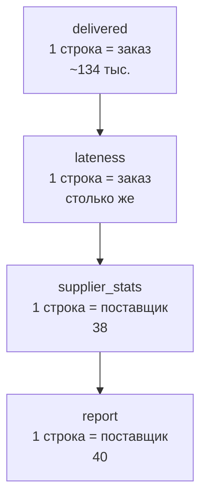

# В.3 CTE и декомпозиция: как собрать сложный запрос по шагам и прочитать чужой

## Зачем это аналитику

Сложный запрос редко бывает сложным из-за синтаксиса. Обычно он сложен потому, что в одном `SELECT` смешаны пять решений: что считать строкой, какие события брать, как обращаться с пустыми значениями, что считать опозданием, как агрегировать. Аналитик, который раскладывает вопрос на шаги и проверяет каждый, находит ошибку в отчёте за десять минут. Аналитик, который пишет один большой запрос, неделями спорит с финансами о расхождении. На собеседовании live-задача «посчитай по каждому поставщику долю опозданий» проверяет именно это: умеете ли вы назвать гранулярность, проверить промежуточный результат и объяснить, почему цифра правильная. Вторая частая задача — «вот запрос из нашего BI, что в нём не так».

## Готовность к модулю

Модуль опирается на темы ниже. Если какая-то из них незнакома или её вопросы для самопроверки даются с трудом, начните с неё.

- [Б.4 SQL и транзакции](../00b-bridge/b4-sql-transactions.md)
- [В.2 Соединения](v2-joins.md)

## Куда ведёт

Тема подробнее раскрывается в модулях:

- [В.4 Оконные функции](v4-window-functions.md)
- [2.4 Планировщик запросов](../02-postgresql/2.4-planner.md)

## Что понять

- [ ] **От вопроса к шагам**: сначала формулировка вопроса и **гранулярность результата** (одна строка = что?), потом шаги, и только потом SQL.
- [ ] Каждый шаг — **CTE с говорящим именем**, у каждого шага известны ключ и ожидаемое число строк; шаги запускаются и проверяются по одному.
- [ ] **Размножение строк** при соединении с таблицей более мелкой гранулярности — главный источник «правдоподобно неверных» отчётов; проверка `count(*)` против `count(DISTINCT key)`.
- [ ] **CTE, подзапрос, временная таблица**: читаемость, однократное вычисление, многошаговое расследование.
- [ ] **Материализация CTE**: с PostgreSQL 12 однократно используемое CTE встраивается в запрос; `MATERIALIZED` и `NOT MATERIALIZED` меняют это поведение.
- [ ] **Рекурсивный CTE**: путь от корня, глубина, свёртка листьев к корню; **защита от циклов** массивом пути или ограничением глубины.
- [ ] **CASE для классификации**: порядок веток важен, первая сработавшая побеждает; `NULL` нужно обработать явно.
- [ ] **LATERAL**: «для каждой строки — свой подзапрос», например последний платёж заказа; без индекса это цикл полных просмотров.
- [ ] **Чтение чужого запроса**: изнутри наружу, гранулярность каждого блока, затем переписать на CTE и сверить с независимым источником.

## Урок

<!-- LESSON:START -->
Все примеры построены на [стенде](lab/README.md) маркетплейса; запросы проверены на PostgreSQL 16.

### Метод: от вопроса к шагам

Задача от руководителя: «Какие поставщики чаще всего опаздывают? Нужны число доставленных заказов, доля опоздавших, средняя задержка опоздавших в днях и тип интеграции».

Прежде чем писать SQL, ответьте на пять вопросов.

1. **Вопрос в одной фразе.** «По каждому поставщику: сколько заказов доставлено, какая их доля доставлена позже обещанного срока и на сколько в среднем опаздывают опоздавшие».
2. **Гранулярность результата.** Одна строка — один поставщик. Значит, в результате 40 строк, включая поставщиков без доставок.
3. **Источник фактов и его гранулярность.** Факт — доставленный заказ: `orders` со статусом `DELIVERED` плюс `shipments.delivered_at`. Одна строка — один заказ. Таблица `order_items` здесь не нужна, и это важно.
4. **Шаги.** Отобрать доставленные заказы → вычислить признак опоздания и задержку → свернуть до поставщика → присоединить справочник.
5. **Проверка каждого шага.** Сколько строк, уникален ли ключ, сколько пустых значений.



### Сначала — как делать не надо

Типичная первая версия пишется одним запросом, «со всеми таблицами на всякий случай»:

```sql
SELECT o.supplier_id,
       count(*) AS delivered_cnt,
       round(100.0 * sum(CASE WHEN sh.delivered_at > o.promised_at THEN 1 ELSE 0 END) / count(*), 1) AS late_pct,
       round(avg(extract(epoch FROM sh.delivered_at - o.promised_at) / 86400), 1) AS avg_delay_days
FROM orders o
JOIN shipments sh ON sh.order_id = o.id
JOIN order_items i ON i.order_id = o.id
WHERE o.status = 'DELIVERED'
GROUP BY o.supplier_id
ORDER BY late_pct DESC
LIMIT 3;
```

```
 supplier_id | delivered_cnt | late_pct | avg_delay_days
-------------+---------------+----------+----------------
          28 |          6921 |     46.0 |            0.7
          32 |          7123 |     45.4 |            0.6
          33 |          7045 |     36.8 |            0.2
```

Цифры выглядят правдоподобно, и в этом опасность. Ошибок три. Соединение с `order_items` размножило каждый заказ по числу позиций, поэтому «доставленных заказов» вдвое больше, чем на самом деле, а доля опозданий взвешена числом позиций. Средняя задержка посчитана по всем заказам, включая пришедшие раньше срока: отрицательные задержки «гасят» положительные. И 555 доставленных заказов без `promised_at` молча попали в знаменатель доли как «не опоздавшие».

### Правильно: шаг за шагом

```sql
WITH delivered AS (            -- 1 строка = доставленный заказ
    SELECT o.id AS order_id, o.supplier_id, o.promised_at, sh.delivered_at
    FROM orders o
    JOIN shipments sh ON sh.order_id = o.id
    WHERE o.status = 'DELIVERED'
),
lateness AS (                  -- 1 строка = заказ; is_late = NULL, если срока нет
    SELECT order_id, supplier_id,
           delivered_at > promised_at AS is_late,
           extract(epoch FROM delivered_at - promised_at) / 86400 AS delay_days
    FROM delivered
),
supplier_stats AS (            -- 1 строка = поставщик с доставками
    SELECT supplier_id,
           count(*)                                AS delivered_cnt,
           count(is_late)                          AS with_promise_cnt,
           avg(is_late::int)                       AS late_share,
           avg(delay_days) FILTER (WHERE is_late)  AS avg_late_days
    FROM lateness
    GROUP BY supplier_id
),
report AS (                    -- 1 строка = поставщик из справочника
    SELECT s.id AS supplier_id, s.integration_type,
           coalesce(st.delivered_cnt, 0)  AS delivered_cnt,
           round(100 * st.late_share, 1)  AS late_pct,
           round(st.avg_late_days, 1)     AS avg_late_days
    FROM suppliers s
    LEFT JOIN supplier_stats st ON st.supplier_id = s.id
)
SELECT *
FROM report
ORDER BY late_pct DESC NULLS LAST;
```

```
 supplier_id | integration_type | delivered_cnt | late_pct | avg_late_days
-------------+------------------+---------------+----------+---------------
          28 | sftp             |          3541 |     46.6 |           2.0
          32 | sftp             |          3621 |     46.1 |           2.0
          33 | sftp             |          3596 |     37.4 |           2.1
 ...
           7 | api              |          3482 |      2.6 |           0.2
          39 | manual           |             0 |          |
          40 | manual           |             0 |          |
```

Теперь видно настоящее: десять поставщиков на SFTP опаздывают в четверти — половине случаев и в среднем на два дня, остальные — в 3–19% случаев и на несколько часов. Поставщики 39 и 40 неактивны, но остались в отчёте с нулём: об этом позаботился `LEFT JOIN` от справочника.

Несколько решений в запросе стоит проговорить вслух. `avg(is_late::int)` — доля, где `NULL` (нет срока) не участвует ни в числителе, ни в знаменателе; `count(is_late)` показывает, по скольким заказам доля посчитана. `FILTER (WHERE ...)` — стандартный синтаксис SQL:2003, но в PostgreSQL он есть, а во многих СУБД нет; переносимый вариант — `avg(CASE WHEN is_late THEN delay_days END)`. Приведение `::int` в стандарте пишется `CAST(is_late AS int)`.

### Проверка шагов: запускать CTE по одному

Главный приём декомпозиции — временно заменить финальный `SELECT` проверкой последнего готового шага:

```sql
WITH delivered AS (
    SELECT o.id AS order_id, o.supplier_id, o.promised_at, sh.delivered_at
    FROM orders o
    JOIN shipments sh ON sh.order_id = o.id
    WHERE o.status = 'DELIVERED'
)
SELECT count(*)                                  AS rows_cnt,
       count(DISTINCT order_id)                  AS orders_cnt,
       count(*) FILTER (WHERE promised_at IS NULL) AS no_promise
FROM delivered;
```

```
 rows_cnt | orders_cnt | no_promise
----------+------------+------------
   134050 |     134050 |        555
```

`rows_cnt = orders_cnt` — ключ уникален, размножения нет. Если бы в шаге было соединение с `order_items`, первое число оказалось бы около 259 тысяч. Эту пару счётчиков полезно держать в голове как рефлекс: после каждого `JOIN` — `count(*)` против `count(DISTINCT ключ)`.

### CTE, подзапрос или временная таблица

| Средство | Когда | Цена |
|---|---|---|
| Подзапрос в `FROM` | Короткий шаг, который читается на месте | Вложенность растёт быстро, читать изнутри наружу |
| CTE (`WITH`) | Шаги одного запроса, отчёт, live-задача | Живёт только в одном запросе |
| Временная таблица (`CREATE TEMP TABLE`) | Расследование из многих запросов к одной дорогой выборке | Нужно пересоздавать, данные — снимок на момент создания |

Временная таблица видна только в вашей сессии и исчезает при отключении. Это рабочий инструмент расследования: дорогой шаг считается один раз, на нём можно построить индекс и задать десять вопросов подряд.

```sql
CREATE TEMP TABLE delivered_facts AS
SELECT o.id AS order_id, o.supplier_id, o.channel, o.created_at,
       o.promised_at, sh.delivered_at,
       sh.delivered_at > o.promised_at AS is_late
FROM orders o
JOIN shipments sh ON sh.order_id = o.id
WHERE o.status = 'DELIVERED';

ALTER TABLE delivered_facts ADD PRIMARY KEY (order_id);  -- заодно проверка уникальности
ANALYZE delivered_facts;                                 -- статистика для планировщика

SELECT created_at::date AS created_date, count(*) AS delivered_cnt,
       round(100 * avg(is_late::int)) AS late_pct
FROM delivered_facts
WHERE supplier_id = 31
  AND created_at >= '2025-07-05' AND created_at < '2025-07-19'
GROUP BY 1
ORDER BY 1;
```

```
 created_date | delivered_cnt | late_pct
--------------+---------------+----------
 2025-07-05   |            10 |       20
 2025-07-06   |            18 |       39
 2025-07-07   |            14 |       36
 2025-07-08   |            16 |      100
 ...
 2025-07-15   |            21 |      100
 2025-07-16   |            15 |       33
```

Второй вопрос к той же таблице — и видно, что заказы поставщика 31, созданные 8–15 июля, опоздали все. Почему — выясним в задачах про фиды.

### Материализация CTE

До PostgreSQL 12 каждое CTE вычислялось отдельно и целиком, и условия внешнего запроса внутрь не проникали. С 12-й версии нерекурсивное CTE без побочных эффектов, на которое ссылаются один раз, встраивается в запрос как обычный подзапрос. Разницу видно в плане:

```sql
EXPLAIN (COSTS OFF)
WITH late AS (
    SELECT order_id, supplier_id FROM delivered_facts WHERE is_late
)
SELECT count(*) FROM late WHERE supplier_id = 31;

EXPLAIN (COSTS OFF)
WITH late AS MATERIALIZED (
    SELECT order_id, supplier_id FROM delivered_facts WHERE is_late
)
SELECT count(*) FROM late WHERE supplier_id = 31;
```

```
 Aggregate
   ->  Seq Scan on delivered_facts
         Filter: (is_late AND (supplier_id = 31))

 Aggregate
   CTE late
     ->  Seq Scan on delivered_facts
           Filter: is_late
   ->  CTE Scan on late
         Filter: (supplier_id = 31)
```

В первом плане оба условия применяются за один проход. Во втором сначала строится весь список опоздавших, и только потом из него выбирается поставщик 31. `MATERIALIZED` полезен, когда дорогое CTE используется несколько раз (так происходит и без подсказки) или нужно намеренно зафиксировать порядок вычислений. Для аналитика вывод простой: CTE — инструмент читаемости, на производительность на современных версиях он почти не влияет. Подробности — в модуле [2.4](../02-postgresql/2.4-planner.md).

### Рекурсивный CTE: дерево категорий

В Б.4 рекурсия строила пути. Здесь задача рабочая: товар привязан к листовому разделу, а отчёт нужен по пяти корневым категориям. Для этого каждому узлу нужен его корень — его протаскивают через рекурсию, как и путь:

```sql
WITH RECURSIVE tree AS (
    SELECT id, parent_id, id AS root_id, name AS root_name,
           1 AS depth, name AS path, ARRAY[id] AS id_path
    FROM categories
    WHERE parent_id IS NULL
    UNION ALL
    SELECT c.id, c.parent_id, t.root_id, t.root_name,
           t.depth + 1, t.path || ' / ' || c.name, t.id_path || c.id
    FROM categories c
    JOIN tree t ON c.parent_id = t.id
    WHERE c.id <> ALL (t.id_path)       -- защита от циклов
)
SELECT id, depth, root_name, path
FROM tree
WHERE id IN (1, 6, 26, 85)
ORDER BY id;
```

```
 id | depth |  root_name  |                   path
----+-------+-------------+------------------------------------------
  1 |     1 | Электроника | Электроника
  6 |     2 | Электроника | Электроника / Подкатегория 1
 26 |     3 | Электроника | Электроника / Подкатегория 1 / Раздел 1
 85 |     3 | Автотовары  | Автотовары / Подкатегория 20 / Раздел 60
```

В дереве 85 узлов на трёх уровнях: 5, 20 и 60. Условие `c.id <> ALL (t.id_path)` не даёт зайти в узел, который уже есть на пути. На чистом справочнике оно ничего не меняет, но справочник категорий правят руками, и однажды кто-то назначит подкатегории родителем её же раздел. Без защиты рекурсия по циклу не остановится. Есть ещё два способа: ограничить глубину (`WHERE t.depth < 10`) — проще, но цикл всё равно размножит строки до предела; и стандартное предложение `CYCLE id SET is_cycle USING path` (PostgreSQL 14+), которое помечает строку, замкнувшую цикл. Если циклический узел недостижим из корня, якорь `parent_id IS NULL` его вообще не увидит; такие «потерянные» узлы ищут отдельной проверкой.

Свёртка к корню — это соединение фактов с `tree` по `products.category_id = tree.id`. Какое это соединение, внутреннее или левое, и куда девать товары без категории — первая задача практики.

### CASE для классификации

Руководитель просит не среднюю задержку, а распределение: вовремя, до суток, 1–3 дня, больше трёх. Это `CASE`, и у него одна ловушка: ветки проверяются по порядку, побеждает первая подошедшая.

```sql
SELECT CASE WHEN sh.delivered_at - o.promised_at <= interval '3 days' THEN '1–3 дня'
            WHEN sh.delivered_at - o.promised_at <= interval '1 day'  THEN 'до 1 дня'
            WHEN sh.delivered_at <= o.promised_at                     THEN 'вовремя'
            ELSE 'больше 3' END AS bucket,
       count(*)
FROM orders o
JOIN shipments sh ON sh.order_id = o.id
WHERE o.status = 'DELIVERED'
GROUP BY 1
ORDER BY 1;
```

```
  bucket  | count
----------+--------
 1–3 дня  | 130290
 больше 3 |   3760
```

Всё, что меньше трёх дней, включая доставленное раньше срока, попало в первую ветку. А 555 заказов без срока оказались в «больше 3»: сравнение с `NULL` даёт `NULL`, ни одна ветка не сработала, и победил `ELSE`. Правильно — ветки от узкой к широкой, `NULL` первой веткой:

```sql
WITH delays AS (
    SELECT sh.delivered_at - o.promised_at AS delay
    FROM orders o
    JOIN shipments sh ON sh.order_id = o.id
    WHERE o.status = 'DELIVERED'
),
bucketed AS (
    SELECT CASE
               WHEN delay IS NULL              THEN '0. нет срока'
               WHEN delay <= interval '0'      THEN '1. вовремя'
               WHEN delay <= interval '1 day'  THEN '2. до 1 дня'
               WHEN delay <= interval '3 days' THEN '3. 1–3 дня'
               ELSE                                 '4. больше 3 дней'
           END AS bucket
    FROM delays
)
SELECT bucket, count(*) AS orders_cnt
FROM bucketed
GROUP BY bucket
ORDER BY bucket;
```

```
      bucket      | orders_cnt
------------------+------------
 0. нет срока     |        555
 1. вовремя       |     113414
 2. до 1 дня      |      12143
 3. 1–3 дня       |       4733
 4. больше 3 дней |       3205
```

Номер в начале подписи — простой способ получить правильный порядок сортировки без отдельного столбца.

### LATERAL: подзапрос для каждой строки

Иногда для каждой строки нужен не агрегат, а одна конкретная строка из связанной таблицы: последний платёж заказа, последний снимок остатка. `LATERAL` разрешает подзапросу в `FROM` ссылаться на столбцы таблиц слева от него:

```sql
SELECT o.id, o.status, lp.status AS last_payment_status, lp.amount, lp.paid_at
FROM orders o
LEFT JOIN LATERAL (
    SELECT p.status, p.amount, p.paid_at
    FROM payments p
    WHERE p.order_id = o.id
    ORDER BY p.paid_at DESC, p.id DESC
    LIMIT 1
) lp ON true
WHERE o.customer_id = 105
ORDER BY o.id;
```

```
   id   |  status   | last_payment_status |  amount   |            paid_at
--------+-----------+---------------------+-----------+-------------------------------
 114261 | DELIVERED | SUCCESS             |  22312.64 | 2025-09-05 05:09:00.473478+00
 ...
 117169 | CANCELLED | REFUND              | -13954.15 | 2025-09-09 21:33:28.61688+00
```

`LEFT JOIN LATERAL ... ON true` сохраняет заказы без платежей. Подзапрос выполняется для каждой строки слева. На стенде у `payments` нет индекса по `order_id`, и каждое выполнение — полный просмотр таблицы: 19 заказов покупателя обходятся в 19 просмотров. Для всех 150 тысяч заказов такой запрос будет работать около четверти часа, поэтому `LATERAL` с `LIMIT 1` пишут вместе с индексом `(order_id, paid_at)`. Для массовой задачи «последнее по каждому» обычно удобнее окно `ROW_NUMBER` — его разбираем в [В.4](v4-window-functions.md). В SQL Server тот же приём называется `OUTER APPLY`.

### Чтение чужого запроса

Вам передали отчёт «Поставщики: качество за III квартал». Он работает давно, но финансы говорят, что выручка в нём «какая-то большая».

```sql
-- Отчёт «Поставщики: качество за III квартал». Автор неизвестен, в BI с весны.
SELECT s.name                                        AS supplier,
       s.integration_type,
       r.orders_cnt,
       r.units,
       r.revenue,
       round(r.revenue / r.orders_cnt, 2)            AS avg_check,
       round(100.0 * r.late_cnt / r.orders_cnt, 1)   AS late_pct,
       r.paid,
       round(100.0 * r.paid / r.revenue, 1)          AS paid_pct
FROM suppliers s
JOIN (
    SELECT d.supplier_id,
           count(d.order_id)                         AS orders_cnt,
           sum(d.qty)                                AS units,
           sum(d.total_amount)                       AS revenue,
           sum(CASE WHEN d.delivered_at > d.promised_at
                    THEN 1 ELSE 0 END)               AS late_cnt,
           sum(d.paid_amount)                        AS paid
    FROM (
        SELECT o.id AS order_id,
               o.supplier_id,
               o.total_amount,
               o.promised_at,
               sh.delivered_at,
               i.qty,
               pm.paid_amount
        FROM orders o
        JOIN shipments sh ON sh.order_id = o.id
        JOIN order_items i ON i.order_id = o.id
        LEFT JOIN (
            SELECT order_id, sum(amount) AS paid_amount
            FROM payments
            WHERE status = 'SUCCESS'
            GROUP BY order_id
        ) pm ON pm.order_id = o.id
        WHERE o.status = 'DELIVERED'
          AND sh.delivered_at >= '2025-07-01'
          AND sh.delivered_at <  '2025-10-01'
    ) d
    GROUP BY d.supplier_id
) r ON r.supplier_id = s.id
WHERE s.id IN (
    SELECT supplier_id
    FROM (
        SELECT supplier_id, count(*) AS cnt
        FROM orders
        WHERE status = 'DELIVERED'
        GROUP BY supplier_id
    ) big
    WHERE big.cnt >= 1000
)
ORDER BY late_pct DESC;
```

```
   supplier   | integration_type | orders_cnt | units |   revenue    | avg_check | late_pct |     paid     | paid_pct
--------------+------------------+------------+-------+--------------+-----------+----------+--------------+----------
 Поставщик 28 | sftp             |       4471 | 14171 | 232921433.02 |  52096.05 |     46.7 | 233217849.30 |    100.1
 Поставщик 32 | sftp             |       4589 | 14324 | 282492426.56 |  61558.60 |     45.2 | 283818668.79 |    100.5
 ...
```

Техника чтения такая.

**1. Читать изнутри наружу и подписать гранулярность каждого блока.** Самый вложенный блок `pm` — одна строка на заказ. Блок `d` соединяет заказы, отгрузки и позиции: одна строка на **позицию** заказа. Блок `r` — поставщик. Блок `big` — поставщик.

| Блок | Одна строка = | Строк | Проверка |
|---|---|---|---|
| `pm` | заказ | ~143 тыс. | ключ `order_id` уникален после `GROUP BY` |
| `d` | позиция заказа | ~162 тыс. на ~84 тыс. заказов | `count(*)` против `count(DISTINCT order_id)` |
| `r` | поставщик | 38 | — |
| `big` | поставщик | 38 | все 38 проходят порог, фильтр ничего не делает |

**2. Для каждого агрегата спросить: на какой гранулярности он корректен.** `sum(d.qty)` по позициям — верно. `count(d.order_id)` считает позиции, а не заказы. `sum(d.total_amount)` складывает сумму заказа столько раз, сколько в нём позиций: за квартал выходит около 8,7 млрд при выручке около 3,4 млрд. Доля опозданий взвешена числом позиций. Средний чек неверен вдвойне.

**3. Найти, почему ошибку не заметили.** Колонка `paid_pct` — встроенная «сверка» выручки с платежами — показывает около 100%. Сверка не ловит ошибку, потому что обе её стороны размножены одинаково. Это общий закон: проверка внутри того же запроса не заменяет сверку с независимым источником, например с витриной `report_daily_revenue`.

**4. Отметить мёртвый и сомнительный код.** Фильтр `big` считает доставленные заказы за всё время, а не за квартал, и не отсекает никого. Сумма платежей берёт оба уведомления, если платёжный сервис прислал одно и то же дважды.

**5. Переписать на CTE с правильной гранулярностью** — каждая мера считается на своём уровне и присоединяется к заказу один к одному:

```sql
WITH delivered_q3 AS (         -- 1 строка = доставленный в III квартале заказ
    SELECT o.id AS order_id, o.supplier_id, o.total_amount, o.promised_at, sh.delivered_at
    FROM orders o
    JOIN shipments sh ON sh.order_id = o.id
    WHERE o.status = 'DELIVERED'
      AND sh.delivered_at >= '2025-07-01' AND sh.delivered_at < '2025-10-01'
),
units AS (                     -- 1 строка = заказ
    SELECT order_id, sum(qty) AS units
    FROM order_items
    WHERE order_id IN (SELECT order_id FROM delivered_q3)
    GROUP BY order_id
),
paid AS (                      -- 1 строка = заказ; двойные уведомления схлопнуты
    SELECT order_id, sum(amount) AS paid_amount
    FROM (SELECT DISTINCT order_id, provider_id, amount
          FROM payments
          WHERE status = 'SUCCESS') p
    GROUP BY order_id
),
per_supplier AS (              -- 1 строка = поставщик
    SELECT d.supplier_id,
           count(*)                                           AS orders_cnt,
           sum(u.units)                                       AS units,
           sum(d.total_amount)                                AS revenue,
           count(*) FILTER (WHERE d.delivered_at > d.promised_at) AS late_cnt,
           count(d.promised_at)                               AS with_promise_cnt,
           sum(coalesce(p.paid_amount, 0))                    AS paid
    FROM delivered_q3 d
    JOIN units u ON u.order_id = d.order_id
    LEFT JOIN paid p ON p.order_id = d.order_id
    GROUP BY d.supplier_id
)
SELECT s.name AS supplier, s.integration_type, ps.orders_cnt, ps.units, ps.revenue,
       round(ps.revenue / ps.orders_cnt, 2)                 AS avg_check,
       round(100.0 * ps.late_cnt / ps.with_promise_cnt, 1)  AS late_pct,
       ps.paid,
       round(100.0 * ps.paid / ps.revenue, 1)               AS paid_pct
FROM per_supplier ps
JOIN suppliers s ON s.id = ps.supplier_id
ORDER BY late_pct DESC;
```

```
   supplier   | integration_type | orders_cnt | units |   revenue    | avg_check | late_pct |     paid     | paid_pct
--------------+------------------+------------+-------+--------------+-----------+----------+--------------+----------
 Поставщик 28 | sftp             |       2275 | 14171 |  91074045.01 |  40032.55 |     46.5 |  90687342.45 |     99.6
 Поставщик 32 | sftp             |       2321 | 14324 | 108402912.29 |  46705.26 |     45.8 | 108242656.83 |     99.9
 ...
```

Число единиц совпало со старым отчётом — значит, база та же. Выручка уменьшилась примерно в 2,5 раза, а сумма по всем поставщикам сходится с витриной BI за квартал с точностью до десятых долей процента (у самой витрины есть свои дефекты, к ним вернёмся в В.4). Доля оплаченного стала чуть меньше 100% — и это уже честный сигнал: часть доставленных заказов оплачена не полностью или не оплачена вовсе. Разбираться с ним будем в В.6.

### Типичные ошибки

- Писать запрос, не назвав гранулярность результата и каждого шага.
- Присоединять таблицу «на всякий случай»: лишний `JOIN` к `order_items` или к журналу тихо размножает строки.
- Проверять отчёт только им самим: «сверка», размноженная вместе с данными, всегда сходится.
- Усреднять задержку по всем заказам вместо опоздавших: досрочные доставки дают отрицательные значения и занижают среднее.
- Ставить широкую ветку `CASE` раньше узкой и забывать про `NULL`, который уходит в `ELSE`.
- Начинать отчёт от фактов, а не от справочника, и терять строки с нулём: поставщики без доставок пропадают из отчёта.
- Рекурсия без защиты от циклов на справочнике, который правят руками.
- `LATERAL ... LIMIT 1` без индекса на большой таблице.

### Как говорить об этом на собеседовании

На live-задаче проговаривайте план до кода: «Результат — строка на поставщика, 40 строк. Факт — доставленный заказ, строка на заказ. Позиции не нужны, их соединение размножит заказы. Заказы без срока исключаю из доли и показываю отдельно. Задержку усредняю только по опоздавшим. Собираю четыре CTE и проверяю число строк после каждого». Такой ответ ценится выше, чем быстро написанный, но непроверенный запрос.

На задаче «найдите ошибку» начинайте с гранулярности: «Блок `d` — строка на позицию, а `count` и `sum(total_amount)` над ним предполагают строку на заказ. Сверка с платежами этого не ловит, потому что размножены обе стороны. Сверил бы итог с витриной за тот же период». Если спрашивают про CTE и производительность: с PostgreSQL 12 однократное CTE встраивается, `MATERIALIZED` возвращает старое поведение.

### Коротко

- Сначала вопрос и гранулярность результата, потом шаги, потом SQL.
- Каждый шаг — CTE с говорящим именем и комментарием «1 строка = ...»; после каждого `JOIN` — `count(*)` против `count(DISTINCT ключ)`.
- Отчёт строится от справочника через `LEFT JOIN`, чтобы не терять нули.
- Временная таблица — для расследования из многих запросов к одной дорогой выборке.
- С PostgreSQL 12 однократное CTE встраивается; `MATERIALIZED` и `NOT MATERIALIZED` задают поведение явно.
- Рекурсия протаскивает корень, путь и глубину; массив пути защищает от циклов.
- В `CASE` порядок веток — от узкой к широкой, `NULL` обрабатывается явно.
- `LATERAL` — «для каждой строки свой подзапрос»; без индекса это цикл полных просмотров.
- Чужой запрос читают изнутри наружу, подписывая гранулярность блоков, и сверяют итог с независимым источником.
<!-- LESSON:END -->

## Читать дальше

- Документация PostgreSQL: [WITH Queries (Common Table Expressions)](https://www.postgresql.org/docs/current/queries-with.html), в том числе разделы [Recursive Queries](https://www.postgresql.org/docs/current/queries-with.html#QUERIES-WITH-RECURSIVE), [Cycle Detection](https://www.postgresql.org/docs/current/queries-with.html#QUERIES-WITH-CYCLE) и [CTE Materialization](https://www.postgresql.org/docs/current/queries-with.html#QUERIES-WITH-CTE-MATERIALIZATION).
- Документация PostgreSQL: [LATERAL Subqueries](https://www.postgresql.org/docs/current/queries-table-expressions.html#QUERIES-LATERAL), [CASE](https://www.postgresql.org/docs/current/functions-conditional.html#FUNCTIONS-CASE).
- Алан Бьюли, «Изучаем SQL» — главы о подзапросах и условной логике.
- Джо Селко, «SQL for Smarties» — главы о деревьях и иерархиях: альтернативы списку смежности.

## Практика

Задачи решаются на стенде. Сначала решите сами с таймером, потом сверяйтесь с разбором.

### Задача 1. Выручка по корневым категориям

Посчитайте выручку доставленных заказов (сумма `qty * price` по позициям) по пяти корневым категориям с помощью рекурсивного CTE. Верните `root_name`, выручку в миллионах рублей и число позиций. Подумайте, куда в отчёте должны попасть товары без категории, и проверьте, что сумма по категориям сходится с суммой по всем позициям. Таймер: 15 минут.

<details markdown="1">
<summary>Решение и разбор</summary>

```sql
WITH RECURSIVE tree AS (
    SELECT id, id AS root_id, name AS root_name, ARRAY[id] AS id_path
    FROM categories
    WHERE parent_id IS NULL
    UNION ALL
    SELECT c.id, t.root_id, t.root_name, t.id_path || c.id
    FROM categories c
    JOIN tree t ON c.parent_id = t.id
    WHERE c.id <> ALL (t.id_path)
),
delivered_lines AS (           -- 1 строка = позиция доставленного заказа
    SELECT i.product_id, i.qty * i.price AS line_amount
    FROM orders o
    JOIN order_items i ON i.order_id = o.id
    WHERE o.status = 'DELIVERED'
),
lines_with_root AS (
    SELECT coalesce(t.root_name, 'Без категории') AS root_name, l.line_amount
    FROM delivered_lines l
    JOIN products p ON p.id = l.product_id
    LEFT JOIN tree t ON t.id = p.category_id
)
SELECT root_name,
       round(sum(line_amount) / 1e6, 1) AS revenue_mln,
       count(*)                          AS lines_cnt
FROM lines_with_root
GROUP BY root_name
ORDER BY revenue_mln DESC;
```

```
   root_name   | revenue_mln | lines_cnt
---------------+-------------+-----------
 Дом и сад     |      1110.0 |     53166
 Стройка       |      1091.2 |     52211
 Офис          |      1072.1 |     48555
 Электроника   |      1057.1 |     50237
 Автотовары    |      1017.2 |     50976
 Без категории |        89.0 |      4148
```

Сумма шести строк — около 5 437 млн, ровно столько же даёт `sum(qty * price)` по всем позициям доставленных заказов. Если соединить с `tree` внутренним `JOIN`, около 89 млн выручки (2% товаров без категории) молча пропадут, и отчёт по категориям не сойдётся с общим итогом. Правильно показывать их отдельной строкой: это задача для справочника, а не повод их прятать.

Вторая сверка: та же выручка по `orders.total_amount` — около 5 434 млн, на 3 млн меньше суммы позиций. Расхождение даёт каждый двухсотый заказ, где в сумме заказа учтена скидка, которой нет в позициях. Для отчёта по категориям других данных нет, поэтому выручка по позициям — осознанный выбор, который стоит подписать в отчёте.

</details>

### Задача 2. Поставщики по типу интеграции

Расширьте отчёт по поставщикам из урока: добавьте итоги по типу интеграции (`api`, `sftp`, `manual`) и общий итог. Для каждой группы: число поставщиков с доставками, число доставленных заказов, доля опоздавших (без заказов без срока), средняя задержка опоздавших в днях. Таймер: 15 минут.

<details markdown="1">
<summary>Решение и разбор</summary>

```sql
WITH delivered AS (
    SELECT o.id AS order_id, o.supplier_id, o.promised_at, sh.delivered_at
    FROM orders o
    JOIN shipments sh ON sh.order_id = o.id
    WHERE o.status = 'DELIVERED'
),
lateness AS (
    SELECT d.order_id, d.supplier_id, s.integration_type,
           d.delivered_at > d.promised_at AS is_late,
           extract(epoch FROM d.delivered_at - d.promised_at) / 86400 AS delay_days
    FROM delivered d
    JOIN suppliers s ON s.id = d.supplier_id
)
SELECT coalesce(integration_type, 'ИТОГО')              AS integration_type,
       count(DISTINCT supplier_id)                       AS suppliers_cnt,
       count(*)                                          AS delivered_cnt,
       round(100 * avg(is_late::int), 1)                 AS late_pct,
       round(avg(delay_days) FILTER (WHERE is_late), 1)  AS avg_late_days
FROM lateness
GROUP BY ROLLUP (integration_type)
ORDER BY integration_type;
```

```
 integration_type | suppliers_cnt | delivered_cnt | late_pct | avg_late_days
------------------+---------------+---------------+----------+---------------
 api              |            25 |         88190 |      8.1 |           0.2
 manual           |             3 |         10700 |      9.8 |           0.2
 sftp             |            10 |         35160 |     33.9 |           2.0
 ИТОГО            |            38 |        134050 |     15.0 |           1.3
```

`ROLLUP` добавляет строку общего итога, где `integration_type` равен `NULL`; `coalesce` подписывает её. Обратите внимание: итоговые 15% — не среднее трёх долей, а доля по всем заказам. Усреднять доли групп нельзя, если группы разного размера.

SFTP опаздывает в три-четыре раза чаще и на порядок сильнее. Ручных поставщиков в отчёте три, а не пять: 39 и 40 неактивны и заказов не получали. Если разбить ещё и по `sla_days`, видно второй фактор: чем короче обещанный срок, тем чаще опоздания внутри любого типа интеграции.

</details>

### Задача 3. Распределение задержек по корзинам

Для каждого типа интеграции посчитайте распределение доставленных заказов по корзинам: нет срока / вовремя / до 1 дня / 1–3 дня / больше 3 дней. Верните тип, корзину, число заказов и долю внутри типа в процентах. Таймер: 10 минут.

<details markdown="1">
<summary>Решение и разбор</summary>

```sql
WITH delays AS (
    SELECT s.integration_type, sh.delivered_at - o.promised_at AS delay
    FROM orders o
    JOIN shipments sh ON sh.order_id = o.id
    JOIN suppliers s ON s.id = o.supplier_id
    WHERE o.status = 'DELIVERED'
),
bucketed AS (
    SELECT integration_type,
           CASE
               WHEN delay IS NULL              THEN '0. нет срока'
               WHEN delay <= interval '0'      THEN '1. вовремя'
               WHEN delay <= interval '1 day'  THEN '2. до 1 дня'
               WHEN delay <= interval '3 days' THEN '3. 1–3 дня'
               ELSE                                 '4. больше 3 дней'
           END AS bucket
    FROM delays
)
SELECT integration_type, bucket, count(*) AS orders_cnt,
       round(100.0 * count(*) / sum(count(*)) OVER (PARTITION BY integration_type), 1) AS pct_in_type
FROM bucketed
GROUP BY integration_type, bucket
ORDER BY integration_type, bucket;
```

```
 integration_type |      bucket      | orders_cnt | pct_in_type
------------------+------------------+------------+-------------
 api              | 0. нет срока     |        372 |         0.4
 api              | 1. вовремя       |      80662 |        91.5
 api              | 2. до 1 дня      |       7156 |         8.1
 manual           | 0. нет срока     |         51 |         0.5
 manual           | 1. вовремя       |       9609 |        89.8
 manual           | 2. до 1 дня      |       1040 |         9.7
 sftp             | 0. нет срока     |        132 |         0.4
 sftp             | 1. вовремя       |      23143 |        65.8
 sftp             | 2. до 1 дня      |       3947 |        11.2
 sftp             | 3. 1–3 дня       |       4733 |        13.5
 sftp             | 4. больше 3 дней |       3205 |         9.1
```

Доля внутри типа посчитана оконной суммой поверх агрегата: `sum(count(*)) OVER (PARTITION BY ...)` — окно вычисляется после `GROUP BY`, подробнее в В.4. Переносимая альтернатива — отдельный CTE с итогом по типу и соединение с ним.

Картина качественно разная: у API и ручных поставщиков опоздание — это часы, корзин «1–3 дня» и «больше 3» нет вовсе. У SFTP каждый пятый заказ опаздывает больше чем на сутки. Средняя задержка этого не показывала.

Обратите внимание на «нет срока»: заказы без `promised_at` есть и у поставщиков на SFTP и вручную, хотя пропуск срока связан с каналом заказа `api`, а не с типом интеграции поставщика. Не путайте `orders.channel` и `suppliers.integration_type`: оба значения называются `api`, но это разные измерения.

</details>

### Задача 4. Найдите ошибку в чужом запросе

Этот запрос из BI считает «оплаты по каналам за сентябрь»: сколько заказов, на какую сумму, сколько оплачено, какой остаток не оплачен и за сколько минут в среднем платят. Отменённые заказы не берутся. Найдите все ошибки, объясните, как каждая влияет на цифры, и перепишите запрос на CTE. Таймер: 20 минут.

```sql
SELECT o.channel,
       count(DISTINCT o.id)                              AS orders_cnt,
       sum(o.total_amount)                               AS amount,
       sum(p.amount)                                     AS paid,
       sum(o.total_amount) - sum(p.amount)               AS unpaid,
       round(avg(extract(epoch FROM h.changed_at - o.created_at) / 60), 1)
                                                         AS avg_minutes_to_pay
FROM orders o
LEFT JOIN payments p ON p.order_id = o.id
LEFT JOIN order_status_history h ON h.order_id = o.id
WHERE o.created_at >= '2025-09-01'
  AND o.created_at <  '2025-10-01'
  AND o.status <> 'CANCELLED'
  AND h.status = 'PAID'
GROUP BY o.channel
ORDER BY o.channel;
```

<details markdown="1">
<summary>Решение и разбор</summary>

Подпишем гранулярность: после двух соединений одна строка — это сочетание «заказ × платёж × событие истории». Условие `h.status = 'PAID'` оставляет одно событие на заказ, а вот платежей у заказа может быть несколько.

Ошибки:

1. **`h.status = 'PAID'` в `WHERE` превращает `LEFT JOIN` в `INNER JOIN`.** Заказы, которые ещё не оплачены (статус `NEW`), не имеют события `PAID` и выпадают целиком. Это ровно те заказы, ради которых считается «неоплаченный остаток». Условие должно стоять в `ON` или в отдельном шаге.
2. **Размножение по платежам.** У части заказов платёжный сервис прислал уведомление дважды: строк две, и `sum(o.total_amount)` и `sum(p.amount)` учитывают такой заказ дважды. `count(DISTINCT o.id)` маскирует проблему в счётчике, но не в суммах.
3. **Разность сумм вместо суммы разностей.** `sum(total_amount) - sum(amount)` над размноженными строками и с `NULL` в `p.amount` (нет платежа): `sum` пропускает `NULL`, а сумма заказа остаётся. Безопаснее считать остаток на уровне заказа: `total_amount - coalesce(paid, 0)`.

```sql
WITH sept_orders AS (          -- 1 строка = неотменённый заказ сентября
    SELECT id AS order_id, channel, total_amount, created_at
    FROM orders
    WHERE created_at >= '2025-09-01' AND created_at < '2025-10-01'
      AND status <> 'CANCELLED'
),
payments_dedup AS (            -- 1 строка = уникальный платёж провайдера
    SELECT DISTINCT ON (provider_id) order_id, provider_id, amount
    FROM payments
    ORDER BY provider_id, paid_at
),
paid_per_order AS (            -- 1 строка = заказ с платежами
    SELECT order_id, sum(amount) AS paid_amount
    FROM payments_dedup
    GROUP BY order_id
),
paid_event AS (                -- 1 строка = заказ, у которого есть событие PAID
    SELECT order_id, min(changed_at) AS paid_at
    FROM order_status_history
    WHERE status = 'PAID'
    GROUP BY order_id
)
SELECT so.channel,
       count(*)                                           AS orders_cnt,
       sum(so.total_amount)                               AS amount,
       sum(coalesce(pp.paid_amount, 0))                   AS paid,
       sum(so.total_amount - coalesce(pp.paid_amount, 0)) AS unpaid,
       count(*) FILTER (WHERE pe.paid_at IS NULL)         AS not_paid_cnt,
       round(avg(extract(epoch FROM pe.paid_at - so.created_at) / 60), 1) AS avg_minutes_to_pay
FROM sept_orders so
LEFT JOIN paid_per_order pp ON pp.order_id = so.order_id
LEFT JOIN paid_event pe     ON pe.order_id = so.order_id
GROUP BY so.channel
ORDER BY so.channel;
```

```
 channel | orders_cnt |    amount    |     paid     |   unpaid   | not_paid_cnt | avg_minutes_to_pay
---------+------------+--------------+--------------+------------+--------------+--------------------
 api     |       7433 | 304695757.59 | 302536781.02 | 2158976.57 |           31 |               15.8
 app     |      13613 | 552660654.73 | 548840190.34 | 3820464.39 |           53 |               15.6
 web     |      16494 | 654301224.70 | 649231180.76 | 5070043.94 |           70 |               15.5
```

Исходный запрос показывал около 37,4 тысячи заказов и неоплаченный остаток около 4,5 млн. Правильный ответ — около 37,5 тысячи заказов и около 11 млн: 154 неоплаченных заказа выпали из-за условия в `WHERE`, а двойные уведомления раздули «оплачено» примерно на 5 млн. Ошибки разнонаправленные и частично компенсируют друг друга, поэтому итог выглядел правдоподобно.

`DISTINCT ON` — синтаксис PostgreSQL; в других СУБД дедупликацию пишут через `ROW_NUMBER() OVER (PARTITION BY provider_id ORDER BY paid_at)` и фильтр `rn = 1`, это тема В.4. Остаток в 11 млн — не только неоплаченные заказы: в нём есть и доставленные заказы без платежа, и платежи на копейки меньше суммы заказа. Разбор этих расхождений — в В.6.

</details>

### Задача 5. Последний платёж по каждому заказу через LATERAL

Для всех заказов стенда найдите последний по времени платёж (`SUCCESS` или `REFUND`) через `LATERAL`. Верните сводку: текущий статус заказа, статус последнего платежа (или пусто, если платежей нет), число заказов. Сначала выполните запрос на одном покупателе и посмотрите план, потом решите, что нужно для запуска по всей таблице. Таймер: 15 минут.

<details markdown="1">
<summary>Решение и разбор</summary>

На одном покупателе запрос из урока работает, но план показывает `Seq Scan on payments` внутри вложенного цикла с `loops`, равным числу заказов покупателя. На 150 тысячах заказов это 150 тысяч полных просмотров таблицы платежей. Без индекса запрос не запускают. На своём стенде индекс можно создать; если не хотите менять стенд, оберните всё в транзакцию с откатом:

```sql
BEGIN;
CREATE INDEX payments_order_paid_idx ON payments (order_id, paid_at);

SELECT o.status AS order_status, lp.status AS last_payment_status, count(*) AS orders_cnt
FROM orders o
LEFT JOIN LATERAL (
    SELECT p.status
    FROM payments p
    WHERE p.order_id = o.id
    ORDER BY p.paid_at DESC, p.id DESC
    LIMIT 1
) lp ON true
GROUP BY 1, 2
ORDER BY 1, 2;
ROLLBACK;
```

```
 order_status | last_payment_status | orders_cnt
--------------+---------------------+------------
 CANCELLED    | REFUND              |       5937
 CANCELLED    |                     |       6400
 DELIVERED    | SUCCESS             |     133603
 DELIVERED    |                     |        447
 NEW          |                     |        480
 PAID         | SUCCESS             |       1207
 SHIPPED      | SUCCESS             |       2226
```

С индексом запрос выполняется меньше чем за секунду. `p.id DESC` во втором ключе сортировки делает выбор однозначным, если у двух платежей совпадёт время.

Как читать результат. Отменённые заказы делятся на отменённые до оплаты (платежей нет) и после оплаты (последний платёж — возврат); отменённых с последним `SUCCESS`, то есть с неоформленным возвратом, нет. Зато 447 доставленных заказов не имеют ни одного платежа — это заложенное расхождение, и `LEFT JOIN LATERAL` его показал. С `CROSS JOIN LATERAL` (аналог внутреннего соединения) эти заказы молча пропали бы из отчёта.

</details>

## Вопросы для самопроверки

1. С каких вопросов вы начинаете, прежде чем писать сложный запрос? Что такое гранулярность результата?
2. Как быстро проверить, что соединение не размножило строки?
3. Почему встроенная в отчёт «сверка» выручки с платежами может показывать 100% при неверной выручке?
4. Когда вы выберете временную таблицу вместо CTE?
5. Что изменилось в обработке CTE в PostgreSQL 12 и зачем нужны `MATERIALIZED` и `NOT MATERIALIZED`?
6. Как в рекурсивном CTE получить для каждого узла его корень и как защититься от циклов?
7. Почему порядок веток в `CASE` важен и что произойдёт со значением `NULL`?
8. Что делает `LATERAL` и почему запрос с `LATERAL ... LIMIT 1` на большой таблице работает очень долго?

## Заметки

<!-- Свои формулировки, ошибки, ссылки. -->
