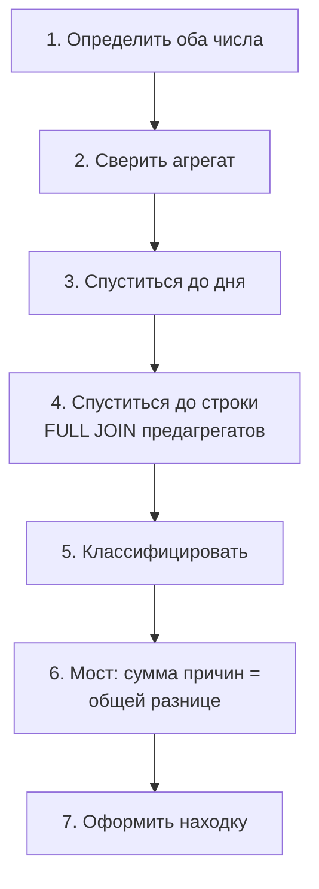

# В.6 Расследование расхождений: почему цифры в двух отчётах не сходятся

## Зачем это аналитику

«Выручка в отчёте руководству не сходится с финансами» — одна из самых частых задач, которые падают на аналитика, и одна из самых показательных. Новичок сравнивает итоги, находит одну причину и останавливается. Опытный аналитик раскладывает разницу на причины до копейки и приходит к разработке с задачей, в которой есть масштаб, примеры и контрольный запрос. На собеседованиях этот сюжет звучит как «два отчёта показывают разное, ваши действия?». Отвечают на него методом, а не догадками.

## Готовность к модулю

Модуль опирается на темы ниже. Если какая-то из них незнакома или её вопросы для самопроверки даются с трудом, начните с неё.

- [В.2 Соединения](v2-joins.md)
- [В.5 Время и даты](v5-dates-timezones.md)

## Куда ведёт

Тема подробнее раскрывается в модулях:

- [В.8 SQL-интервью и сквозной кейс](v8-interview-case.md)
- [9.5 Качество данных](../09-data-platforms/9.5-data-quality-governance.md)

## Что понять

- [ ] **Сначала определения, потом SQL**: что считается, за какой период, в каком поясе, по какому событию, с какими статусами, из какого источника.
- [ ] **Спуск по уровням**: агрегат → день → строка. Каждый уровень сужает поиск.
- [ ] **Сравнение строк — `FULL OUTER JOIN` двух предагрегированных наборов** по общему ключу. Без предагрегации соединение размножает строки.
- [ ] **Классификация**: у каждой расходящейся строки есть ровно одна причина (или явно указанное сочетание).
- [ ] **Мост между цифрами (reconciliation bridge)**: сумма объяснённых расхождений равна общей разнице, остаток — ноль. Пока остаток не ноль, расследование не закончено.
- [ ] **Разные события — разные даты**: оплата и доставка одного заказа попадают в разные месяцы; это не ошибка, а различие определений.
- [ ] **«Тихие» сбои** не видны по статусу ошибки: успешная загрузка с нулём строк, двойная загрузка.
- [ ] **Находка оформляется как задача**: факт, масштаб в деньгах и штуках, примеры, гипотеза, правило, критерии приёмки, контрольный запрос.

## Урок

<!-- LESSON:START -->
Все примеры — на базе [стенда](lab/README.md), запросы проверены на PostgreSQL 16, сессия в UTC.

### Метод в семь шагов



Первый шаг важнее всех остальных. Для каждого из двух чисел выпишите: **что** суммируется (сумма заказа, сумма позиций, платежи), **за какой период** и **по какому событию** (создание, оплата, доставка), **в каком поясе** режутся сутки, **какие статусы** входят, **из какого источника** (оперативная таблица, витрина, выгрузка). Половина расхождений объясняется уже на этом шаге, без единого запроса.

### Кейс 1. Витрина BI против пересчёта

Отчёт руководству строится по витрине `report_daily_revenue`. Комментарий к таблице говорит только «выручка доставленных заказов по дням»; уточнённое у BI определение — по дню доставки в UTC, `sum(orders.total_amount)`. Пересчитаем то же самое по `shipments` и `orders` за июль–август.

**Шаг 2, агрегат.**

```sql
WITH recalc AS (
    SELECT s.delivered_at::date AS report_date, count(*) AS orders_cnt, sum(o.total_amount) AS revenue
    FROM shipments s
    JOIN orders o ON o.id = s.order_id
    WHERE s.delivered_at >= timestamptz '2025-07-01' AND s.delivered_at < timestamptz '2025-09-01'
    GROUP BY 1
)
SELECT (SELECT sum(revenue) FROM report_daily_revenue
        WHERE report_date BETWEEN date '2025-07-01' AND date '2025-08-31') AS bi_revenue,
       (SELECT sum(revenue) FROM recalc) AS recalc_revenue;
```

```
   bi_revenue  | recalc_revenue
---------------+----------------
 1919774108.48 |  1918882319.88
```

Разница около 0,9 млн рублей, меньше 0,05%. Очень хочется списать её на «округление» — и это классическая ошибка: малая разница на агрегате может скрывать две большие разнонаправленные.

**Шаги 3–4, день и строка.** Сначала частая ошибка — соединить витрину с фактами напрямую:

```sql
-- НЕПРАВИЛЬНО: строка витрины размножается на каждую отгрузку дня
SELECT sum(b.revenue) AS bi_revenue
FROM report_daily_revenue b
JOIN shipments s ON s.delivered_at::date = b.report_date
WHERE b.report_date BETWEEN date '2025-07-01' AND date '2025-08-31';
-- 1499738634270.93
```

1,5 триллиона вместо 1,9 миллиарда. Гранулярность разная (день против заказа), поэтому каждую сторону сначала доводим до общего ключа — дня, — а потом соединяем полным внешним соединением, чтобы увидеть дни, которых нет с одной из сторон:

```sql
WITH bi AS (
    SELECT report_date, sum(revenue) AS revenue, count(*) AS load_rows
    FROM report_daily_revenue
    WHERE report_date BETWEEN date '2025-07-01' AND date '2025-08-31'
    GROUP BY report_date
),
recalc AS (
    SELECT s.delivered_at::date AS report_date, sum(o.total_amount) AS revenue
    FROM shipments s
    JOIN orders o ON o.id = s.order_id
    WHERE s.delivered_at >= timestamptz '2025-07-01' AND s.delivered_at < timestamptz '2025-09-01'
    GROUP BY 1
)
SELECT coalesce(b.report_date, r.report_date) AS report_date,
       b.load_rows, b.revenue AS bi_revenue, r.revenue AS recalc_revenue,
       coalesce(b.revenue, 0) - coalesce(r.revenue, 0) AS diff
FROM bi b
FULL OUTER JOIN recalc r ON r.report_date = b.report_date
WHERE b.revenue IS DISTINCT FROM r.revenue
ORDER BY 1;
```

```
 report_date | load_rows | bi_revenue  | recalc_revenue |     diff
-------------+-----------+-------------+----------------+--------------
 2025-07-12  |           |             |    27337548.75 | -27337548.75
 2025-08-03  |         2 | 56458674.70 |    28229337.35 |  28229337.35
```

Две причины по 27–28 млн, взаимно погасившие друг друга почти целиком: день 12 июля в витрину не загружен, 3 августа загружен дважды (видно по `load_rows = 2` и по `loaded_at` с разницей 6 часов). `IS DISTINCT FROM` вместо `<>` нужен, потому что с одной стороны может быть NULL. Без `FULL OUTER JOIN` (с `JOIN` или `LEFT JOIN` от витрины) пропавший день вы бы не увидели вообще.

Важная проверка определения: если повторить тот же запрос в сессии `Europe/Moscow`, `delivered_at::date` режет сутки по Москве и расходятся все 62 дня июля–августа. Витрина построена по UTC — сверка должна идти в том же поясе.

### Кейс 2. Финансы против доставленной выручки

Финансы считают выручку сентября как платежи `SUCCESS` минус возвраты `REFUND` по дате `paid_at`. Коммерческий отчёт — как сумму позиций заказов, доставленных в сентябре. Определения:

| | Финансы | Коммерция |
|---|---|---|
| Что | `payments.amount` (с возвратами) | `sum(qty * price)` по `order_items` |
| Событие и дата | оплата, `paid_at` | доставка, `delivered_at` |
| Статусы | все заказы с платежами | доставленные |
| Итог за сентябрь | ~1 507,4 млн | ~1 473,4 млн |

Разница около 34 млн. Уже из таблицы видно главную причину: события разные. Заказ, оплаченный 29 сентября, будет доставлен в октябре и войдёт только в финансы; доставленный 1 сентября оплачен в августе и войдёт только в коммерцию. По дням финансы и коммерция расходятся во всех 30 днях, в большинстве — на миллионы и в обе стороны, поэтому сверка по дням здесь бесполезна — сразу спускаемся до заказа.

Ключ сравнения — заказ. Каждую сторону агрегируем до заказа (платежей у заказа может быть несколько, позиций — несколько), соединяем `FULL OUTER JOIN` и каждой расходящейся строке приписываем причину. Важно, что причины не пересекаются: двойное уведомление вычитается из суммы платежа до сравнения с заказом, иначе одни и те же деньги попадут в две строки моста. Полный запрос — в задаче 2. Результат:

```
                  reason                   | orders |    amount
-------------------------------------------+--------+---------------
 1. Двойное уведомление о платеже          |    150 |    5394220.70
 2. Скидка не отражена в позициях          |    169 |    -765074.05
 3. Платёж не равен сумме заказа           |    171 |        -84.24
 4. Оплаты и возвраты отменённых заказов   |    163 |    1103312.52
 5. Оплачен в сентябре, доставка позже     |   3428 |  140456990.25
 6. Доставлен в сентябре, оплачен раньше   |   2652 | -107381893.49
 7. Доставлен без платежа                  |    116 |   -4773033.67
 Итого: финансы минус доставленная выручка |   6801 |   34034438.02
```

Итог совпадает с общей разницей до копейки — это и есть мост. Как его читать:

- Строки 5 и 6 — **различие определений**, не ошибка. Их нужно показать бизнесу и договориться, какой отчёт для чего.
- Строка 4 — тоже определение: финансы видят оплату и возврат отменённого заказа, а если оплата и возврат попали в разные месяцы, остаётся «хвост».
- Строки 1, 2, 3 и 7 — **дефекты данных или процессов**: платёжный сервис присылает уведомление дважды; у каждого 200-го заказа сумма на 10% меньше позиций (скидка без строки скидки); у части заказов платёж меньше суммы на копейки; около сотни доставленных заказов без единого платежа.

Ловушка размножения здесь тоже есть: если соединить `payments` с `order_items` без предагрегации, сумма платежей за сентябрь становится 3,85 млрд вместо 1,51 — каждый платёж повторяется по числу позиций.

### Кейс 3. Две «истины» о времени отгрузки

Операционный отчёт считает отгрузки по журналу `order_status_history` (событие `SHIPPED`), логистика — по `shipments.shipped_at`. За сентябрь журнал даёт 37 890, `shipments` — 37 161. Мост в штуках:

```sql
WITH hist AS (
    SELECT h.order_id, h.changed_at, o.supplier_id,
           row_number() OVER (PARTITION BY h.order_id ORDER BY h.changed_at) AS event_no
    FROM order_status_history h
    JOIN orders o ON o.id = h.order_id
    WHERE h.status = 'SHIPPED'
),
bridge AS (
    SELECT 'журнал: все события SHIPPED' AS step, count(*) AS cnt
    FROM hist
    WHERE changed_at >= timestamptz '2025-09-01' AND changed_at < timestamptz '2025-10-01'
    UNION ALL
    SELECT 'журнал: повторные события', -count(*)
    FROM hist
    WHERE event_no > 1
      AND changed_at >= timestamptz '2025-09-01' AND changed_at < timestamptz '2025-10-01'
    UNION ALL
    SELECT 'сдвиг −3 ч у поставщика 33: перенос через границу месяца',
           count(*) FILTER (WHERE changed_at + interval '3 hours' >= timestamptz '2025-09-01'
                              AND changed_at + interval '3 hours' <  timestamptz '2025-10-01')
         - count(*) FILTER (WHERE changed_at >= timestamptz '2025-09-01'
                              AND changed_at <  timestamptz '2025-10-01')
    FROM hist
    WHERE event_no = 1 AND supplier_id = 33
    UNION ALL
    SELECT 'shipments: отгрузки за месяц', -count(*)
    FROM shipments
    WHERE shipped_at >= timestamptz '2025-09-01' AND shipped_at < timestamptz '2025-10-01'
)
SELECT step, cnt FROM bridge
UNION ALL
SELECT 'остаток (должен быть 0)', sum(cnt) FROM bridge;
```

```
                           step                           |  cnt
----------------------------------------------------------+--------
 журнал: все события SHIPPED                              |  37890
 журнал: повторные события                                |   -734
 сдвиг −3 ч у поставщика 33: перенос через границу месяца |      5
 shipments: отгрузки за месяц                             | -37161
 остаток (должен быть 0)                                  |      0
```

Основная разница — дубли события при ретраях (каждый 50-й заказ, через секунду). На уровне месяца сдвиг пояса у поставщика 33 даёт всего 5 штук, но по дням он сильнее: после удаления дублей дневные счётчики журнала и `shipments` всё ещё расходятся в 26 днях из 30, а после поправки на 3 часа — ни в одном. Сам сдвиг найден в [В.5](v5-dates-timezones.md) распределением разницы. Вывод для требований: эталон времени отгрузки — `shipments`; журнал пригоден для последовательности статусов только после дедупликации и нормализации пояса.

### Кейс 4. «Тихий» сбой интеграции

Мониторинг фидов смотрит на `status = 'ERROR'` — их около 150, и у каждой ошибки есть успешный повтор. Мониторинг «зелёный». Но успешная загрузка с нулём строк и двойная загрузка за день статуса ошибки не имеют. Их ищут по **норме**: сколько успешных загрузок в день ожидается и сколько строк обычно приходит.

```sql
WITH daily AS (
    SELECT supplier_id, loaded_at::date AS day,
           count(*) FILTER (WHERE status = 'OK')         AS ok_loads,
           max(rows_loaded) FILTER (WHERE status = 'OK') AS max_rows
    FROM supplier_feed_loads
    GROUP BY supplier_id, loaded_at::date
),
norm AS (
    SELECT supplier_id, percentile_cont(0.5) WITHIN GROUP (ORDER BY max_rows) AS median_rows
    FROM daily
    WHERE ok_loads > 0
    GROUP BY supplier_id
),
issues AS (
    SELECT d.supplier_id, d.day,
           CASE WHEN d.ok_loads > 0 AND d.max_rows < 0.5 * n.median_rows THEN 'успешная, но пустая или неполная'
                WHEN d.ok_loads > 1 THEN 'несколько успешных загрузок за день'
           END AS issue
    FROM daily d
    JOIN norm n USING (supplier_id)
)
SELECT supplier_id, issue, count(*) AS days, min(day) AS first_day, max(day) AS last_day
FROM issues
WHERE issue IS NOT NULL
GROUP BY supplier_id, issue
ORDER BY supplier_id, issue;
```

```
 supplier_id |                issue                | days | first_day  |  last_day
-------------+-------------------------------------+------+------------+------------
          33 | успешная, но пустая или неполная    |    6 | 2025-09-03 | 2025-09-12
          34 | несколько успешных загрузок за день |   31 | 2025-08-01 | 2025-08-31
```

Шесть дней пустых «успешных» загрузок у поставщика 33 (две серии по три дня) и весь август двойных загрузок у поставщика 34. Порог «вдвое меньше медианы» — пример; конкретное правило согласуйте с владельцем интеграции и запишите. `percentile_cont` — упорядоченный агрегат стандарта SQL; в других СУБД он есть как `PERCENTILE_CONT ... WITHIN GROUP` или оконная функция. Дни без загрузок вообще (поставщик 31) этот запрос не видит — для них нужен календарь из В.5.

### Чек-лист типовых причин

Когда метод привёл к строкам, причину обычно находят в этом списке:

1. **Дубли**: двойная загрузка, повторное уведомление, ретрай события, двойной клик пользователя.
2. **Пропуски загрузки**: день, файл или партия не дошли.
3. **Разные определения**: событие (оплата против доставки), сумма (заказ против позиций), статусы.
4. **Часовой пояс и граница суток**: один источник режет сутки по UTC, другой — по местному времени; источник пишет местное время как UTC.
5. **Момент снимка и поздние данные**: отчёт построен в 04:00, а часть событий за вчера пришла позже; данные «будущего» (возвраты после конца периода).
6. **Фильтры статусов**: одна сторона исключает отменённые, другая нет.
7. **Размножение строк при соединении**: разная гранулярность сторон.
8. **Округление**: сумма округлённых не равна округлённой сумме; копеечные расхождения сумм.
9. **Ручные корректировки**: правки в одной системе, не повторённые в другой.

### Как оформить находку

Находка без масштаба и способа проверки — это жалоба, а не задача. Структура: **факт** (что расходится), **масштаб** (в деньгах и штуках, за период), **примеры** (идентификаторы, по которым разработчик воспроизведёт), **гипотеза причины**, **предлагаемое правило или исправление**, **критерии приёмки**, **контрольный запрос** (что он должен вернуть после исправления). Пример:

> **Двойные уведомления платёжного сервиса завышают выручку финансов**
>
> **Факт.** В `payments` 548 значений `provider_id` встречаются дважды, со статусом `SUCCESS` и той же суммой; вторая запись приходит через 2 секунды после первой.
>
> **Масштаб.** За 1 апреля — 30 сентября 2025: 548 заказов, лишние 21,5 млн рублей; за сентябрь — 150 заказов и 5,4 млн. Затрагивает каждый 250-й оплаченный заказ, равномерно по времени.
>
> **Примеры.** Заказы 250, 500, 750; за сентябрь — 109500, 109750, 110000.
>
> **Гипотеза.** Платёжный сервис повторяет уведомление, не получив вовремя подтверждения, а приёмник не проверяет идемпотентность по `provider_id`.
>
> **Предложение.** Сделать приём уведомлений идемпотентным: уникальность по (`provider_id`, `status`), повтор подтверждать без вставки. Существующие дубли пометить и исключить из финансовой отчётности.
>
> **Критерии приёмки.** 1) Повторное уведомление с тем же `provider_id` и статусом не создаёт новой строки и подтверждается провайдеру. 2) Контрольный запрос возвращает 0 строк. 3) Выручка финансов за апрель–сентябрь уменьшается ровно на 21 472 091,10.
>
> **Контрольный запрос.**
> ```sql
> SELECT provider_id, status, count(*)
> FROM payments
> GROUP BY provider_id, status
> HAVING count(*) > 1;
> ```

### Типичные ошибки

- Сравнивать только итоги и списывать малую разницу на округление.
- Начинать с SQL, не выписав определения обоих чисел.
- Соединять наборы разной гранулярности без предагрегации.
- `JOIN` или `LEFT JOIN` вместо `FULL OUTER JOIN`: строки, которых нет с одной стороны, исчезают.
- `<>` вместо `IS DISTINCT FROM` при сравнении с возможным NULL.
- Пересекающиеся причины: одни и те же деньги объяснены дважды, мост «сходится» случайно или не сходится.
- Остановиться на первой найденной причине, не проверив, что остаток моста — ноль.
- Сверять источники в разных поясах сессии.
- Мониторить только статус ошибки и пропускать «тихие» сбои.

### Как говорить об этом на собеседовании

Расскажите метод, а не запрос: сначала уточню определения обоих чисел, затем сверю агрегат, спущусь до дня и до строки через полное внешнее соединение предагрегатов, разложу разницу на причины и покажу мост, где сумма причин равна разнице. Отдельно отделите различия определений (их согласуют с бизнесом) от дефектов (их чинит разработка) и скажите, что каждая находка уходит в работу с контрольным запросом. Если есть реальный пример из опыта с цифрами — это сильнее любого синтаксиса.

### Коротко

- Определения обоих чисел — до первого запроса.
- Агрегат → день → строка.
- Сравнение — `FULL OUTER JOIN` предагрегатов по общему ключу.
- Причины не пересекаются; сумма причин = общей разнице, остаток — ноль.
- Различия определений согласуют, дефекты чинят.
- «Тихие» сбои ищутся по норме, а не по статусу.
- Находка = факт, масштаб, примеры, гипотеза, правило, критерии, контрольный запрос.
<!-- LESSON:END -->

## Читать дальше

- Документация PostgreSQL: [Table Expressions — Joined Tables](https://www.postgresql.org/docs/current/queries-table-expressions.html#QUERIES-JOIN) (`FULL OUTER JOIN`), [GROUPING SETS, CUBE и ROLLUP](https://www.postgresql.org/docs/current/queries-table-expressions.html#QUERIES-GROUPING-SETS), [Ordered-Set Aggregate Functions](https://www.postgresql.org/docs/current/functions-aggregate.html#FUNCTIONS-ORDEREDSET-TABLE) (`percentile_cont`), [Comparison Functions and Operators](https://www.postgresql.org/docs/current/functions-comparison.html) (`IS DISTINCT FROM`).
- Joe Celko, «SQL for Smarties» — главы о NULL, внешних соединениях и группировке.
- Алан Бьюли, «Изучаем SQL» — главы о соединениях и группировке.

## Практика

Задачи решаются на стенде. Сначала решите сами с таймером, потом сверяйтесь с разбором.

### Задача 1. Мост между витриной и пересчётом за весь период

Сравните витрину `report_daily_revenue` с пересчётом по `shipments` и `orders` за весь период (1 апреля — 30 сентября). Верните мост: причина, число дней, разница в заказах, разница в деньгах и итоговую строку. Таймер: 15 минут.

<details markdown="1">
<summary>Решение и разбор</summary>

```sql
WITH bi AS (
    SELECT report_date, sum(orders_cnt) AS orders_cnt, sum(revenue) AS revenue, count(*) AS load_rows
    FROM report_daily_revenue
    GROUP BY report_date
),
recalc AS (
    SELECT s.delivered_at::date AS report_date, count(*) AS orders_cnt, sum(o.total_amount) AS revenue
    FROM shipments s
    JOIN orders o ON o.id = s.order_id
    WHERE s.delivered_at IS NOT NULL
    GROUP BY 1
),
compared AS (
    SELECT coalesce(b.revenue, 0) AS bi_revenue, coalesce(r.revenue, 0) AS recalc_revenue,
           coalesce(b.orders_cnt, 0) AS bi_cnt, coalesce(r.orders_cnt, 0) AS recalc_cnt,
           CASE WHEN b.report_date IS NULL THEN 'день отсутствует в витрине'
                WHEN r.report_date IS NULL THEN 'день есть только в витрине'
                WHEN b.load_rows > 1 THEN 'день загружен ' || b.load_rows || ' раза'
                WHEN b.revenue <> r.revenue THEN 'суммы не совпадают'
                ELSE 'совпадает' END AS reason
    FROM bi b
    FULL OUTER JOIN recalc r ON r.report_date = b.report_date
)
SELECT coalesce(reason, 'итого') AS reason,
       count(*) AS days,
       sum(bi_cnt - recalc_cnt) AS diff_orders,
       sum(bi_revenue - recalc_revenue) AS diff_revenue
FROM compared
GROUP BY ROLLUP (reason)
ORDER BY GROUPING(reason), reason;   -- итоговая строка последней
```

```
           reason           | days | diff_orders | diff_revenue
----------------------------+------+-------------+--------------
 день загружен 2 раза       |    1 |         721 |  28229337.35
 день отсутствует в витрине |    1 |        -677 | -27337548.75
 совпадает                  |  181 |           0 |         0.00
 итого                      |  183 |          44 |    891788.60
```

Сумма двух причин равна итоговой разнице, остальные 181 день совпадают до копейки. Строк витрины 183, а различных дат 182: один день пропал, один задвоен — поэтому `count(*)` по витрине «правильный», и на взгляд всё в порядке. В ветке `bi` агрегация по дате обязательна: без неё задвоенный день дал бы две строки в соединении и удвоил бы пересчёт.

Дефекты видны и без моста, простыми контролями, которые стоит предложить BI как постоянные проверки: `GROUP BY report_date HAVING count(*) > 1` (вернёт 3 августа) и антисоединение с календарём из `generate_series` (вернёт 12 июля). `ROLLUP` есть в стандарте SQL; где его нет, итог добавляют через `UNION ALL`.

</details>

### Задача 2. Финансы против доставленной выручки за сентябрь

Разложите разницу между выручкой финансов (сумма `payments.amount` по `paid_at` в сентябре, включая возвраты) и выручкой доставленных заказов (сумма `qty * price` позиций заказов с `delivered_at` в сентябре) на причины. Для каждой причины — число заказов и сумма; итог должен равняться общей разнице. Таймер: 35 минут.

<details markdown="1">
<summary>Решение и разбор</summary>

```sql
WITH pay_sept AS (
    SELECT p.*,
           row_number() OVER (PARTITION BY provider_id ORDER BY paid_at, id) AS copy_no
    FROM payments p
    WHERE paid_at >= timestamptz '2025-09-01' AND paid_at < timestamptz '2025-10-01'
),
fin AS (                    -- финансы: деньги по заказу за сентябрь
    SELECT order_id,
           sum(amount) AS fin_amount,
           coalesce(sum(amount) FILTER (WHERE copy_no > 1), 0) AS dup_amount
    FROM pay_sept
    GROUP BY order_id
),
dlv AS (                    -- коммерция: позиции заказов, доставленных в сентябре
    SELECT s.order_id, sum(i.qty * i.price) AS items_amount
    FROM shipments s
    JOIN order_items i ON i.order_id = s.order_id
    WHERE s.delivered_at >= timestamptz '2025-09-01' AND s.delivered_at < timestamptz '2025-10-01'
    GROUP BY s.order_id
),
cmp AS (
    SELECT coalesce(f.order_id, d.order_id) AS order_id,
           f.fin_amount, f.dup_amount, d.items_amount,
           o.status, o.total_amount,
           EXISTS (SELECT 1 FROM payments p WHERE p.order_id = coalesce(f.order_id, d.order_id)) AS has_any_payment
    FROM fin f
    FULL OUTER JOIN dlv d ON d.order_id = f.order_id
    JOIN orders o ON o.id = coalesce(f.order_id, d.order_id)
),
parts AS (                  -- каждая причина объясняет свою, непересекающуюся часть денег
    SELECT order_id, '1. Двойное уведомление о платеже' AS reason, dup_amount AS amount
    FROM cmp WHERE dup_amount <> 0
    UNION ALL
    SELECT order_id, '2. Скидка не отражена в позициях', total_amount - items_amount
    FROM cmp WHERE fin_amount IS NOT NULL AND items_amount IS NOT NULL AND total_amount <> items_amount
    UNION ALL
    SELECT order_id, '3. Платёж не равен сумме заказа', fin_amount - dup_amount - total_amount
    FROM cmp WHERE fin_amount IS NOT NULL AND items_amount IS NOT NULL AND fin_amount - dup_amount <> total_amount
    UNION ALL
    SELECT order_id,
           CASE WHEN status = 'CANCELLED' THEN '4. Оплаты и возвраты отменённых заказов'
                ELSE '5. Оплачен в сентябре, доставка позже' END,
           fin_amount - dup_amount
    FROM cmp WHERE items_amount IS NULL
    UNION ALL
    SELECT order_id,
           CASE WHEN has_any_payment THEN '6. Доставлен в сентябре, оплачен раньше'
                ELSE '7. Доставлен без платежа' END,
           -items_amount
    FROM cmp WHERE fin_amount IS NULL
)
SELECT coalesce(reason, 'Итого: финансы минус доставленная выручка') AS reason,
       count(DISTINCT order_id) AS orders,
       sum(amount) AS amount
FROM parts
WHERE amount <> 0
GROUP BY ROLLUP (reason)
ORDER BY reason NULLS LAST;
```

Результат приведён в уроке; итог 34 034 438,02 равен разнице 1 507 437 151,89 − 1 473 402 713,87. Проверка моста отдельным запросом обязательна: посчитайте обе суммы независимо и сравните с итоговой строкой.

Как устроена непересекаемость. Для заказа, который есть с обеих сторон, разница `fin_amount − items_amount` раскладывается тождественно: `dup_amount` (лишние уведомления) + `(fin_amount − dup_amount − total_amount)` (платёж против суммы заказа) + `(total_amount − items_amount)` (скидка). Для заказов с одной стороны вся сумма идёт в одну причину. Порядок вычитания важен: если сначала сравнить платёж с заказом, двойное уведомление попадёт в «переплату», а потом ещё раз в «дубли».

Что увидеть в цифрах: 3428 заказов «оплачен, но ещё не доставлен» — это статусы `PAID` и `SHIPPED` на конец сентября; 163 отменённых заказа с ненулевым итогом — оплата и возврат попали в разные месяцы (возвраты есть даже с датой в октябре, позже «сейчас» стенда — это поздние данные). 116 доставленных заказов без единого платежа — дефект (ещё один такой заказ с суммой 0 в мост не попадает, потому что ничего не меняет). `row_number()` по `provider_id` — приём дедупликации из В.4.

</details>

### Задача 3. Заказы, где деньги не равны сумме заказа

По всему периоду найдите заказы, у которых чистая сумма платежей (`SUCCESS` плюс `REFUND`) не равна ожидаемой: `total_amount` для заказов в статусах `PAID`, `SHIPPED`, `DELIVERED` и 0 для `NEW` и `CANCELLED`. Классифицируйте расхождения, для каждого класса верните число заказов, сумму разницы, пример `id`, минимальную и максимальную разницу. Таймер: 20 минут.

<details markdown="1">
<summary>Решение и разбор</summary>

```sql
WITH pay AS (
    SELECT order_id,
           sum(amount) AS net_amount,
           count(*) FILTER (WHERE status = 'SUCCESS') AS success_cnt,
           count(DISTINCT provider_id) FILTER (WHERE status = 'SUCCESS') AS success_ids
    FROM payments
    GROUP BY order_id
),
checked AS (
    SELECT o.id, o.status,
           coalesce(p.net_amount, 0) AS net_amount,
           CASE WHEN o.status IN ('CANCELLED', 'NEW') THEN 0 ELSE o.total_amount END AS expected,
           p.success_cnt, p.success_ids
    FROM orders o
    LEFT JOIN pay p ON p.order_id = o.id
)
SELECT CASE
           WHEN success_cnt > success_ids        THEN 'двойное уведомление'
           WHEN net_amount = 0 AND expected > 0  THEN 'нет платежа'
           WHEN status = 'CANCELLED'             THEN 'возврат не равен оплате'
           WHEN abs(net_amount - expected) <= 1  THEN 'копеечное расхождение'
           ELSE 'прочее'
       END AS issue,
       count(*) AS orders,
       sum(net_amount - expected) AS diff,
       min(id) AS example_id,
       min(net_amount - expected) AS min_diff,
       max(net_amount - expected) AS max_diff
FROM checked
WHERE net_amount <> expected
GROUP BY 1
ORDER BY orders DESC;
```

```
          issue          | orders |     diff     | example_id |  min_diff  | max_diff
-------------------------+--------+--------------+------------+------------+-----------
 копеечное расхождение   |    695 |      -347.65 |        203 |      -0.99 |     -0.01
 двойное уведомление     |    548 |  21472091.10 |        250 |      99.46 | 256622.49
 нет платежа             |    445 | -18276063.29 |          7 |  -281816.60 |   -101.57
 возврат не равен оплате |     22 |       -11.01 |       7603 |      -1.00 |     -0.09
```

Четыре класса, «прочего» нет — это хороший признак полноты классификации. Порядок веток CASE важен: двойное уведомление проверяется первым, иначе оно попадёт в «прочее». Класс «возврат не равен оплате» — продолжение копеечного: платёж был меньше суммы заказа на копейки, а возврат сделан на полную сумму заказа, так что покупателю вернули больше, чем он заплатил. Это уже вопрос к процессу возвратов, а не только к данным.

Доставленных без платежа на самом деле 447, но у двух из них сумма заказа 0, и разницы нет — проверьте `WHERE status = 'DELIVERED' AND NOT EXISTS (...)`. Ловушка: если сравнивать с `sum(qty * price)` вместо `total_amount`, к каждому классу примешаются заказы со скидкой без позиции, и картина станет нечитаемой. Сравнивайте деньги с той суммой, которую платёжный сервис должен был списать.

</details>

### Задача 4. Все «тихие» сбои фидов

Найдите все дни, когда загрузка фида формально была успешной, но по сути сбойной: пустая или неполная успешная загрузка, больше одной успешной загрузки за день. Верните поставщика, тип проблемы, число дней, первый и последний день. Затем объясните, почему мониторинг по `status = 'ERROR'` их не видит. Таймер: 20 минут.

<details markdown="1">
<summary>Решение и разбор</summary>

Запрос — из раздела «Кейс 4» урока. Результат: поставщик 33 — 6 дней пустых успешных загрузок (3–5 и 10–12 сентября), поставщик 34 — 31 день двойных загрузок (весь август).

Сначала посмотрите на простые факты, чтобы выбрать пороги: `rows_loaded` у успешных непустых загрузок лежит в узком диапазоне 118–125, ошибки (`status = 'ERROR'`, около 150) всегда пишутся с `rows_loaded = 0` и у каждой есть успешный повтор через час. Поэтому правило «больше одной успешной загрузки в день» не ловит обычные повторы после ошибки — у тех одна успешная. Если бы считать все загрузки, а не только `OK`, вы получили бы около 150 ложных тревог.

Последствия: при пустом фиде у маркетплейса не обновляются остатки и цены поставщика 33; двойная загрузка у 34-го безвредна для остатков, но удваивает нагрузку и, если загрузка не идемпотентна, может удвоить строки в приёмнике — это нужно проверить отдельно. Предложение для требований: мониторинг по трём правилам — нет успешной загрузки в ожидаемый день (календарь из В.5), успешная загрузка с числом строк ниже порога от нормы, больше одной успешной загрузки за день.

</details>

### Задача 5. Оформить находку как задачу

Выберите одну находку из задач 1–4, кроме двойных уведомлений (пример есть в уроке), и оформьте её как задачу для разработки: факт, масштаб в деньгах и штуках, примеры идентификаторов, гипотеза причины, предлагаемое правило, критерии приёмки, контрольный запрос с ожидаемым результатом после исправления. Таймер: 20 минут.

<details markdown="1">
<summary>Решение и разбор</summary>

Пример для витрины BI:

> **Витрина `report_daily_revenue`: пропуск и повторная загрузка дня**
>
> **Факт.** В витрине нет строки за 2025-07-12, а за 2025-08-03 две одинаковые строки (`loaded_at` 04:00 и 10:00 4 августа).
>
> **Масштаб.** Июль занижен на 677 заказов и 27,3 млн рублей, август завышен на 721 заказ и 28,2 млн. За полугодие ошибки почти взаимно гасятся (+44 заказа, +0,9 млн), поэтому на итоге не видны.
>
> **Гипотеза.** Загрузка за 12 июля упала и не была перезапущена; 4 августа загрузку перезапустили вручную, и она добавила строку вместо замены.
>
> **Предложение.** Загрузка дня — идемпотентная (удалить и вставить за дату в одной транзакции, или `INSERT ... ON CONFLICT (report_date) DO UPDATE` при уникальном ключе на `report_date`). Ежедневный контроль полноты календаря. Перезагрузить 12 июля и 3 августа.
>
> **Критерии приёмки.** 1) Уникальность `report_date` обеспечена ограничением. 2) Повторный запуск загрузки за любой день не меняет итог витрины. 3) Оба контрольных запроса возвращают 0 строк. 4) Мост из задачи 1 даёт нулевую разницу за весь период.
>
> **Контрольные запросы.**
> ```sql
> SELECT report_date, count(*) FROM report_daily_revenue GROUP BY report_date HAVING count(*) > 1;
>
> SELECT d::date AS missing_day
> FROM generate_series(date '2025-04-01', date '2025-09-30', interval '1 day') AS d
> WHERE NOT EXISTS (SELECT 1 FROM report_daily_revenue r WHERE r.report_date = d::date);
> ```

Сейчас первый запрос возвращает 2025-08-03, второй — 2025-07-12. Проверьте свой текст по вопросам: может ли разработчик воспроизвести проблему по примерам, не открывая ваш ноутбук? Понятно ли, как доказать, что исправлено? Отделено ли «что не так» от «как предлагаю исправить»? Масштаб должен быть в той единице, которая важна читателю: для бизнеса — деньги, для разработки — строки и дни.

</details>

## Вопросы для самопроверки

1. Два отчёта о выручке расходятся на 0,05%. Можно ли списать это на округление? Что вы сделаете?
2. Какие шесть параметров нужно выписать для каждого из сравниваемых чисел до первого запроса?
3. Почему для сравнения наборов на уровне строк нужен именно `FULL OUTER JOIN` и почему обе стороны нужно предагрегировать?
4. Что такое мост между цифрами и когда расследование можно считать законченным?
5. Финансы и коммерция расходятся за месяц на 34 млн. Какие причины — различие определений, а какие — дефекты? Кто и что делает с каждой группой?
6. Как не объяснить одни и те же деньги двумя причинами?
7. Мониторинг загрузок «зелёный», а остатки у поставщика устарели. Где искать и какие правила мониторинга предложить?
8. Из каких частей состоит хорошо оформленная находка и зачем в ней контрольный запрос?

## Заметки

<!-- Свои формулировки, ошибки, ссылки. -->
