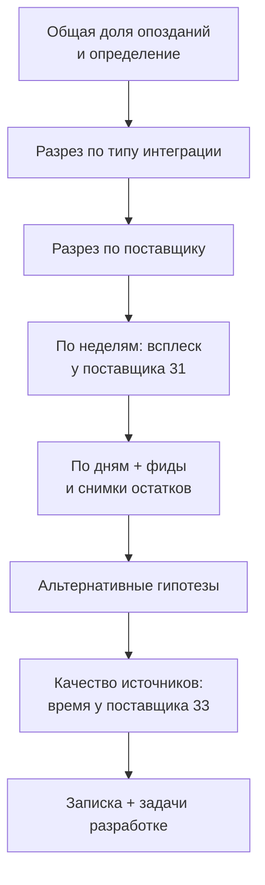

# В.8 SQL-интервью и сквозной кейс: «почему опаздывают заказы»

## Зачем это аналитику

SQL-задача есть почти в каждом собеседовании аналитика, и проваливают её чаще не из-за синтаксиса, а из-за хода решения: человек молча пишет запрос, не уточнив, что считать заказом, не проверяет края и не может объяснить, почему ответ верный. Вторая проверка — тестовое задание или первая неделя на проекте: «вот база, разберитесь, почему опаздывают заказы». Этот модуль собирает этап: алгоритм ответа вслух, десять типовых задач с ловушками и сквозное расследование, которое заканчивается запиской руководству и задачами для разработки. Его же можно рассказывать на собеседовании как пример своей работы с данными.

## Готовность к модулю

Модуль опирается на темы ниже. Если какая-то из них незнакома или её вопросы для самопроверки даются с трудом, начните с неё.

- [В.4 Оконные функции](v4-window-functions.md)
- [В.6 Расследование расхождений](v6-reconciliation.md)
- [В.7 Быстрые запросы](v7-query-performance.md)

## Куда ведёт

Тема подробнее раскрывается в модулях:

- [11.5 Поведенческое интервью](../11-architect-role/11.5-behavioral-interview.md)
- [9.5 Качество данных](../09-data-platforms/9.5-data-quality-governance.md)

## Что понять

- [ ] **Форматы SQL-проверки**: live coding, задача на дом, разговор по данным, чтение чужого запроса — и что в каждом оценивают.
- [ ] **Алгоритм вслух**: гранулярность и определения → допущения → план шагами → запрос по шагам с проверкой → края → поведение на больших данных.
- [ ] Что делать, если **застрял**: упрощённая версия задачи и честное «чего не хватает».
- [ ] Десять **типовых задач** и где в каждой ловят: равенства при ранжировании, знаменатель доли, пустые периоды, дубли, `NULL`.
- [ ] Расследование как **воронка разрезов**: общая доля → тип интеграции → поставщик → неделя → день → причина в соседней таблице.
- [ ] **Альтернативные гипотезы** проверяются запросом, а не отбрасываются словами: сезонность, канал, сегмент, знаменатель, `NULL`.
- [ ] Как **дефект времени** у одного источника искажает метрики, посчитанные по истории статусов.
- [ ] Результат в двух форматах: **записка руководству** (факты, вывод, рекомендация) и **задачи разработке** (критерии приёмки, контрольный запрос).

## Урок

<!-- LESSON:START -->
Примеры выполняются на [стенде](lab/README.md); запросы проверены на PostgreSQL 16. Числа — с этого стенда.

### Форматы проверки

| Формат | Как выглядит | Что оценивают |
|---|---|---|
| Live coding | Общий редактор или песочница, 20–40 минут, 1–3 задачи | Ход мысли вслух, порядок шагов, реакцию на подсказку |
| Задача на дом | База или CSV, несколько вопросов, срок 2–5 дней | Корректность, проверки, оформление выводов |
| Разговор по данным | «Вот схема. Как бы вы посчитали удержание?» — без запуска | Определения, гранулярность, понимание ловушек |
| Чтение чужого запроса | «Что вернёт этот запрос? Где ошибка?» | Умение увидеть размножение, `NULL`, фильтр не на месте |

Во всех четырёх форматах важнее не синтаксис, а то, задаёте ли вы правильные вопросы. Опечатку в `PARTITION BY` интервьюер простит, молчаливое допущение «отменённые тоже считаем» — нет.

### Алгоритм решения вслух

Задача: «Найдите второго по выручке поставщика».

1. **Уточнить гранулярность и определения.** Что такое выручка — сумма доставленных заказов, оплат или всех созданных? За какой период? Что, если у двух поставщиков одинаковая выручка — кто второй? Вслух: «Считаю выручкой сумму `total_amount` доставленных заказов за весь период. При равенстве верну всех, кто делит второе место».
2. **Назвать допущения.** «`total_amount` у части заказов не совпадает с суммой позиций — беру `total_amount`, как в отчётах».
3. **Проговорить план шагами.** «Агрегирую до поставщика, ранжирую, фильтрую ранг 2».
4. **Писать по шагам и проверять каждый.** Запустить первое CTE: 38 строк, по одной на поставщика — гранулярность та, что ожидалась.
5. **Проверить края.** `NULL`, дубли, пустые периоды, равенства при ранжировании, деление на ноль.
6. **Объяснить поведение на больших данных.** «Один проход по `orders` с группировкой; на миллиардах строк — по витрине или с индексом по статусу и сумме».

```sql
WITH supplier_revenue AS (
    SELECT supplier_id, sum(total_amount) AS revenue
    FROM orders
    WHERE status = 'DELIVERED'
    GROUP BY supplier_id
),
ranked AS (
    SELECT supplier_id, revenue,
           dense_rank() OVER (ORDER BY revenue DESC) AS rnk
    FROM supplier_revenue
)
SELECT supplier_id, revenue
FROM ranked
WHERE rnk = 2;
```

```
 supplier_id |   revenue
-------------+--------------
          32 | 167621223.37
```

**Если застряли.** Решите упрощённую версию и скажите это: «Без оконных функций: `ORDER BY revenue DESC LIMIT 1 OFFSET 1` — но это неверно при равенствах, исправлю через ранг». Или назовите, чего не хватает: «Не помню синтаксис `percentile_cont`, логика такая: упорядочить и взять середину». Тишина хуже частичного ответа.

### Десять типовых задач

Каждая — условие, ядро решения и место, где ловят. Подробные разборы техник — в [В.4](v4-window-functions.md), [В.5](v5-dates-timezones.md) и [В.6](v6-reconciliation.md); здесь — как отвечать.

**1. Второе по величине значение.** Решение выше. Ловят на `LIMIT 1 OFFSET 1` и на `ROW_NUMBER` — оба при равенстве выбирают произвольного. `DENSE_RANK` возвращает всех со вторым значением, `RANK` при двух первых местах второго места не даст вовсе — спросите, что нужно бизнесу. На стенде равенств в выручке нет, но в задаче «второй по продажам товар у каждого поставщика» они есть у трёх поставщиков.

**2. Топ-N в группе.** «Три покупателя с наибольшей выручкой в каждом регионе»: агрегат до покупателя и региона, `ROW_NUMBER() OVER (PARTITION BY region ORDER BY revenue DESC, customer_id)`, фильтр `rn <= 3` во внешнем запросе. Ловят на попытке фильтровать оконную функцию в `WHERE` того же уровня и на отсутствии второго ключа сортировки.

**3. Доля от целого.** Доля выручки по типу интеграции: `sum(x) / sum(sum(x)) OVER ()` — оконная функция поверх агрегата. Ловят на знаменателе: доля «от всех заказов» и «от доставленных» — разные числа, и `WHERE` меняет знаменатель. Ещё — целочисленное деление: `100 * count(a) / count(*)` в PostgreSQL даёт целое, нужно `100.0`.

**4. Нарастающий итог.** `sum(revenue) OVER (PARTITION BY date_trunc('month', day) ORDER BY day)` — выручка с начала месяца. Ловят на пропущенных днях (итог «стоит», но дня в выводе нет — нужен календарь) и на неуникальном ключе сортировки: при `ORDER BY` с повторами окно по умолчанию (`RANGE`) суммирует равные строки вместе.

**5. Дедупликация.** Оставить одну строку на покупателя с одинаковым `lower(email)`: `ROW_NUMBER() OVER (PARTITION BY lower(email) ORDER BY registered_at, id)` и `rn = 1` — на стенде 19 850 людей из 20 000 записей. Ловят на вопросе «что считать дублем» — его нужно задать до запроса.

**6. Последнее состояние.** «Последний статус заказа», «последняя успешная загрузка фида». `ROW_NUMBER ... ORDER BY ts DESC` или `DISTINCT ON` (PostgreSQL). Ловят на состоянии **на дату** (фильтр по времени до ранжирования, а не после) и на том, что «последняя загрузка» и «последняя успешная непустая загрузка» — разные вещи.

**7. Острова: N дней подряд.** Покупатели, заказывавшие четыре и более дня подряд. Приём: `day - ROW_NUMBER() OVER (PARTITION BY customer_id ORDER BY day)` одинаков внутри серии подряд идущих дней.

```sql
WITH days AS (
    SELECT DISTINCT customer_id, created_at::date AS day
    FROM orders
    WHERE status <> 'CANCELLED'
),
islands AS (
    SELECT customer_id, day,
           day - (row_number() OVER (PARTITION BY customer_id ORDER BY day))::int AS island
    FROM days
)
SELECT customer_id, min(day) AS start_day, max(day) AS end_day, count(*) AS days_in_row
FROM islands
GROUP BY customer_id, island
HAVING count(*) >= 4
ORDER BY days_in_row DESC, customer_id;
```

723 покупателя, рекорд — 13 дней подряд. Ловят на `DISTINCT`: без него два заказа в один день ломают серию, и покупателей получается 946 — лишние «серии» составлены из повторов одного дня.

**8. Удержание по когортам.** Когорта — месяц первого заказа; доля вернувшихся в следующие месяцы. Ловят на цензурировании: у августовской когорты «удержание через два месяца» — октябрь, которого в данных нет, и запрос честно показывает 0%. Ненаблюдаемые ячейки должны быть пустыми, а не нулями (подробно — задача 6 в [В.5](v5-dates-timezones.md)).

**9. Сводная таблица.** Статусы по каналам в столбцах: `count(*) FILTER (WHERE status = 'DELIVERED')` и так далее. `FILTER` — синтаксис PostgreSQL и стандарта, переносимо — `sum(CASE WHEN ... THEN 1 ELSE 0 END)`. Ловят на статусах, которых нет в списке столбцов: строки «пропадают» из сводной, хотя есть в итоге. Контроль — столбец с общим `count(*)`.

**10. Поиск пропусков в последовательности.** Сначала проверьте, есть ли что искать: в `orders`, `shipments` и `payments` идентификаторы на стенде сплошные (`max(id) = count(*)`, разрывов 0) — и это стоит сказать вслух, как и то, что разрывы суррогатного ключа ничего не значат. Осмысленный вариант — пропуски в датах:

```sql
WITH s AS (
    SELECT product_id, snapshot_date,
           lead(snapshot_date) OVER (PARTITION BY product_id ORDER BY snapshot_date) AS next_date
    FROM stock_snapshots
)
SELECT snapshot_date + 1 AS gap_from, next_date - 1 AS gap_to,
       count(*) AS products
FROM s
WHERE next_date - snapshot_date > 1
GROUP BY 1, 2;
```

```
  gap_from  |   gap_to   | products
------------+------------+----------
 2025-07-10 | 2025-07-14 |       10
```

Десять товаров без снимков остатков пять дней — запомните эти даты для кейса. Ловят на краях: `LEAD` не видит пропуска до первой и после последней строки; полная проверка — календарь `generate_series` и антисоединение.

**Медиана** — частый одиннадцатый вопрос. `percentile_cont(0.5) WITHIN GROUP (ORDER BY x)` — стандарт SQL, есть не во всех СУБД. Ловят на смысле: медиана суммы доставленного заказа около 20,7 тыс., среднее — 40,5 тыс. Распределение скошено крупными заказами, и «средний чек» вводит в заблуждение. У sftp-поставщиков медианный срок доставки около 3 дней при среднем 3,5 и 90-м перцентиле 6,5 — длинный хвост опозданий.

### Сквозной кейс: «почему опаздывают заказы»

Постановка, как на тестовом задании: «Руководство недовольно сроками доставки. Разберитесь, что происходит, и предложите, что делать». Подробное решение — в практике; здесь — ход расследования.



**Определение.** Опоздал — доставлен позже `promised_at`. Сразу три вопроса: что делать с ещё не доставленными (если срок прошёл — опоздал, иначе в знаменатель не берём), с отменёнными (не считаем) и с `promised_at IS NULL` (срок неизвестен — исключаем и говорим об этом). Срез сохраняем во временную таблицу, как в [В.7](v7-query-performance.md): дальше десяток разрезов по нему.

**Воронка.** Общая доля — около 15%. По типу интеграции картина резко разная: api около 8%, manual около 10%, sftp около 35%. Внутри sftp все десять поставщиков в диапазоне 26–47% — это системная проблема файлового обмена, а не один плохой поставщик. По неделям у поставщика 31 один выброс: неделя 7 июля — 92% опозданий при обычных 30–35%. По дням: все 144 заказа, созданные 8–15 июля, опоздали. Соседняя таблица объясняет почему: 10–14 июля от поставщика 31 не было ни одной загрузки фида, и снимков остатков по его товарам за эти дни тоже нет. Заказы принимались по устаревшим остаткам, и время от отгрузки до доставки выросло с 3 до 9 дней.

**Альтернативные гипотезы.** Каждую закрывает запрос: у остальных sftp-поставщиков в июле обычные 35%, сезонности нет; в окне 8–15 июля опоздали 100% заказов в каждом сочетании канала и сегмента, так что дело не в канале; «двойные клики» отменены и в знаменатель не попадают; 555 заказов без `promised_at` исключены и на выводы не влияют.

**Качество источника.** Если посчитать опоздания по истории статусов, а не по `shipments`, у поставщика 33 доля опозданий получается 35% вместо 37%: его система пишет события на 3 часа раньше. Метрики по журналу у него занижены, а 112 заказов «отгружены раньше оплаты».

### Типичные ошибки

- Начинать писать запрос до вопроса «что такое одна строка результата».
- `LIMIT`/`OFFSET` или `ROW_NUMBER` для «второго по величине» без разговора о равенствах.
- Доля, у которой `WHERE` незаметно поменял знаменатель; целочисленное деление.
- Нули в ячейках, которые ещё не наблюдались (когорты, последняя неделя).
- В расследовании — остановиться на первом объяснении и не проверить альтернативные.
- Записка руководству с запросами вместо фактов, задача разработке без критериев приёмки.

### Как говорить об этом на собеседовании

Комментируйте решения, а не синтаксис: «Беру `DENSE_RANK`, потому что при равенстве нужно вернуть всех», «Фильтрую до окна, иначе ранжирую всю историю». В конце задачи сами назовите края, которые проверили, и что сделали бы на больших данных. Кейс рассказывается по схеме ситуация — задача — действия — результат (как в [11.5](../11-architect-role/11.5-behavioral-interview.md)), с цифрами: «Доля опозданий 15%, но это среднее по двум мирам: api — 8%, файловый обмен — 35%. Внутри файлового нашёл пятидневный пропуск фида у одного поставщика, из-за которого опоздали все его заказы за неделю, и сдвиг времени у другого, искажавший метрики по журналу. Предложил мониторинг фидов по календарю и исправление пояса, с контрольными запросами».

### Коротко

- Сначала определения и гранулярность, потом план вслух, потом запрос по шагам.
- Края: `NULL`, дубли, пустые периоды, равенства, знаменатель, цензурирование.
- Ранжирование с равенствами — `DENSE_RANK`/`RANK`, а не `LIMIT OFFSET`.
- Острова — «дата минус номер»; пропуски — `LEAD` или календарь с антисоединением.
- Расследование — воронка разрезов, затем причина в соседних таблицах, затем проверка альтернатив.
- Результат — короткая записка с цифрами и задачи разработке с контрольными запросами.
<!-- LESSON:END -->

## Читать дальше

- Документация PostgreSQL: [Window Functions](https://www.postgresql.org/docs/current/functions-window.html), [Aggregate Functions](https://www.postgresql.org/docs/current/functions-aggregate.html) (`FILTER`, `percentile_cont`), [WITH Queries](https://www.postgresql.org/docs/current/queries-with.html).
- Joe Celko, «SQL for Smarties» — классические головоломки на SQL: пропуски, серии, медианы.
- Алан Бьюли, «Изучаем SQL» — для быстрого повторения синтаксиса перед собеседованием.

## Практика

Пробное интервью. Каждую задачу решайте с таймером, проговаривая шаги вслух или письменно: определения, план, края. Решение открывайте только после таймера. Последним — сквозной кейс как итоговое задание.

### Задача 1. Второй по продажам товар у каждого поставщика

Для каждого поставщика верните товар (или товары), который на втором месте по проданным штукам в доставленных заказах. Столбцы: `supplier_id`, `product_id`, `units`. Таймер: 10 минут.

<details markdown="1">
<summary>Решение и разбор</summary>

```sql
WITH product_units AS (
    SELECT o.supplier_id, i.product_id, sum(i.qty) AS units
    FROM orders o
    JOIN order_items i ON i.order_id = o.id
    WHERE o.status = 'DELIVERED'
    GROUP BY o.supplier_id, i.product_id
),
ranked AS (
    SELECT supplier_id, product_id, units,
           dense_rank() OVER (PARTITION BY supplier_id ORDER BY units DESC) AS rnk
    FROM product_units
)
SELECT supplier_id, product_id, units
FROM ranked
WHERE rnk = 2
ORDER BY supplier_id, product_id;
```

41 строка на 38 поставщиков: у поставщиков 4, 20 и 30 по два товара делят второе место. С `ROW_NUMBER` вы бы молча потеряли один из них, и результат менялся бы от запуска к запуску. Что сказать вслух: «При равенстве возвращаю всех, это `DENSE_RANK`. Если нужен ровно один — договоримся о втором ключе, например меньший `product_id`». Ещё одно уточнение, которое стоит произнести: повторно заведённые артикулы (товары 4961–5000) считаются отдельными товарами, хотя по сути это те же позиции.

</details>

### Задача 2. Сводная по сегментам с долями

Одна строка на сегмент (`B2B`, `B2C`): число доставленных и отменённых заказов, доля отмен от всех заказов сегмента в процентах и доля сегмента в выручке доставленных заказов. Таймер: 10 минут.

<details markdown="1">
<summary>Решение и разбор</summary>

```sql
SELECT c.segment,
       count(*) FILTER (WHERE o.status = 'DELIVERED') AS delivered,
       count(*) FILTER (WHERE o.status = 'CANCELLED') AS cancelled,
       round(100.0 * count(*) FILTER (WHERE o.status = 'CANCELLED') / count(*), 1) AS cancel_pct,
       round(100.0 * sum(o.total_amount) FILTER (WHERE o.status = 'DELIVERED')
             / sum(sum(o.total_amount) FILTER (WHERE o.status = 'DELIVERED')) OVER (), 1) AS revenue_share_pct
FROM orders o
JOIN customers c ON c.id = o.customer_id
GROUP BY c.segment
ORDER BY c.segment;
```

```
 segment | delivered | cancelled | cancel_pct | revenue_share_pct
---------+-----------+-----------+------------+-------------------
 B2B     |     53612 |      4931 |        8.2 |              40.0
 B2C     |     80438 |      7406 |        8.2 |              60.0
```

Ловушки: `WHERE o.status = 'DELIVERED'` в основном запросе сломал бы долю отмен (знаменатель только доставленные). Доля выручки без фильтра по статусу дала бы 40,1% вместо 40,0% — разница мала, но это другая метрика, и на интервью вас спросят, какую вы посчитали. `100.0`, а не `100`, — иначе целочисленное деление. Около 300 отменённых копий «двойного клика» входят в `cancelled`; если доля отмен — метрика качества сервиса, их стоит исключить и сказать об этом.

</details>

### Задача 3. Выручка с начала месяца

По дням доставки (UTC) — выручка дня и нарастающий итог с начала месяца. Покажите 29 июня — 2 июля. Таймер: 10 минут.

<details markdown="1">
<summary>Решение и разбор</summary>

```sql
WITH daily AS (
    SELECT sh.delivered_at::date AS day, sum(o.total_amount) AS revenue
    FROM shipments sh
    JOIN orders o ON o.id = sh.order_id
    WHERE sh.delivered_at IS NOT NULL
    GROUP BY 1
),
mtd AS (
    SELECT day, revenue,
           sum(revenue) OVER (PARTITION BY date_trunc('month', day) ORDER BY day) AS revenue_mtd
    FROM daily
)
SELECT day, revenue, revenue_mtd
FROM mtd
WHERE day BETWEEN date '2025-06-29' AND date '2025-07-02'
ORDER BY day;
```

```
    day     |   revenue   | revenue_mtd
------------+-------------+--------------
 2025-06-29 | 23699666.79 | 680110764.83
 2025-06-30 | 25150143.97 | 705260908.80
 2025-07-01 | 24155031.30 |  24155031.30
 2025-07-02 | 22883025.88 |  47038057.18
```

1 июля итог начинается заново — это `PARTITION BY` месяца. Главная ловушка — где стоит фильтр по дням. Если написать `WHERE day BETWEEN ...` в том же `SELECT`, что и окно, или ограничить даты в `daily`, окно увидит только четыре дня, и 29 июня `revenue_mtd` окажется равен выручке дня (23,7 млн вместо 680 млн). `WHERE` выполняется до оконных функций, поэтому фильтр по показу ставится во внешнем запросе. Проверка, которую стоит назвать вслух: итог последнего дня месяца равен сумме месяца. И второй край: если в каком-то дне доставок не было, строки дня не будет — для отчёта «по каждому дню» нужен календарь.

</details>

### Задача 4. Четыре дня подряд

Покупатели, которые делали неотменённые заказы четыре и более календарных дня подряд (UTC). Верните покупателя, начало и конец серии, длину. Сколько таких покупателей? Таймер: 15 минут.

<details markdown="1">
<summary>Решение и разбор</summary>

Запрос — в разделе «Острова» урока. 723 покупателя, 801 серия (у некоторых по две), самая длинная — 13 дней у покупателя 13060 (11–23 сентября).

Как объяснять: «Беру уникальные пары покупатель — день. Нумерую дни покупателя по порядку. У дней, идущих подряд, разность даты и номера постоянна — это идентификатор острова. Группирую по нему и оставляю острова длиной от 4». Ловушки: без `DISTINCT` в первом шаге получится 946 покупателей — два заказа в один день дают два номера на одну дату, и серия «удлиняется». Даты — в UTC; если бизнес мыслит московскими сутками, серии будут другими (см. [В.5](v5-dates-timezones.md)). Если спросят о других СУБД: вычитание целого из даты — PostgreSQL; в других — `DATEADD(day, -rn, day)` или аналог.

</details>

### Задача 5. Состояние на момент

Представьте, что сейчас 14 июля 2025 года, 12:00 UTC. Какие активные поставщики не присылали успешный непустой фид больше суток? Для каждого — время последней хорошей загрузки и её возраст. Таймер: 15 минут.

<details markdown="1">
<summary>Решение и разбор</summary>

```sql
WITH last_good AS (
    SELECT supplier_id, loaded_at,
           row_number() OVER (PARTITION BY supplier_id ORDER BY loaded_at DESC) AS rn
    FROM supplier_feed_loads
    WHERE status = 'OK'
      AND rows_loaded > 0
      AND loaded_at < timestamptz '2025-07-14 12:00'
)
SELECT s.id AS supplier_id, s.integration_type,
       lg.loaded_at AS last_good_load,
       timestamptz '2025-07-14 12:00' - lg.loaded_at AS age
FROM suppliers s
LEFT JOIN last_good lg ON lg.supplier_id = s.id AND lg.rn = 1
WHERE s.is_active
  AND (lg.loaded_at IS NULL
       OR lg.loaded_at < timestamptz '2025-07-14 12:00' - interval '1 day')
ORDER BY age DESC NULLS FIRST;
```

```
 supplier_id | integration_type |     last_good_load     |       age
-------------+------------------+------------------------+-----------------
          31 | sftp             | 2025-07-09 03:36:00+00 | 5 days 08:24:00
```

Три ловушки. Фильтр «на момент» стоит внутри CTE, до ранжирования; если поставить его снаружи, вы возьмёте последнюю загрузку за всё время (30 сентября) и ничего не найдёте. «Последняя загрузка» и «последняя хорошая загрузка» — разное: если проверить так 12 сентября без условия `rows_loaded > 0`, поставщик 33 выглядит здоровым — его последняя загрузка «успешная», но пустая; с условием видно, что хорошей не было с 9 сентября. `LEFT JOIN` и `IS NULL` — чтобы не потерять поставщика, у которого хороших загрузок не было вообще. Ручные поставщики по выходным не грузят: в понедельник утром правило «больше суток» для них даст ложную тревогу — на это нужно календарное правило.

</details>

### Задача 6. Медиана и среднее

По типу интеграции посчитайте медиану, среднее и 90-й перцентиль срока от создания заказа до доставки в днях. Что вы скажете бизнесу, глядя на sftp? Таймер: 10 минут.

<details markdown="1">
<summary>Решение и разбор</summary>

```sql
SELECT s.integration_type,
       round(percentile_cont(0.5) WITHIN GROUP (
           ORDER BY extract(epoch FROM sh.delivered_at - o.created_at) / 86400)::numeric, 2) AS median_days,
       round(avg(extract(epoch FROM sh.delivered_at - o.created_at) / 86400)::numeric, 2) AS avg_days,
       round(percentile_cont(0.9) WITHIN GROUP (
           ORDER BY extract(epoch FROM sh.delivered_at - o.created_at) / 86400)::numeric, 2) AS p90_days
FROM orders o
JOIN shipments sh ON sh.order_id = o.id
JOIN suppliers s ON s.id = o.supplier_id
WHERE sh.delivered_at IS NOT NULL
GROUP BY s.integration_type
ORDER BY s.integration_type;
```

```
 integration_type | median_days | avg_days | p90_days
------------------+-------------+----------+----------
 api              |        2.18 |     2.33 |     3.64
 manual           |        1.98 |     2.09 |     3.17
 sftp             |        2.98 |     3.49 |     6.49
```

У api и manual медиана и среднее близки, у sftp среднее заметно выше медианы, а 90-й перцентиль — 6,5 дня: типичный заказ доставляется за 3 дня, но каждый десятый — за неделю и дольше. Бизнесу: «Проблема sftp не в типичном сроке, а в хвосте». `extract(epoch FROM interval)` — PostgreSQL; в других СУБД — `DATEDIFF` в секундах или часах. Ловушка: `avg(delivered_at - created_at)` в PostgreSQL вернёт интервал вида `3 days 11:42:...` — читать и сравнивать его неудобно, а в других СУБД вычитание дат ведёт себя иначе. На интервью безопаснее сразу перевести срок в числа с понятной единицей.

</details>

### Итоговое задание. Почему опаздывают заказы

Время: 2–3 часа, как на тестовом задании.

Руководство недовольно сроками доставки. Используя стенд, ответьте:

1. Какова доля опоздавших заказов и как вы её определили?
2. Где опоздания сосредоточены: тип интеграции, поставщики, периоды?
3. Есть ли эпизоды, объяснимые конкретным сбоем? Докажите связь данными из других таблиц.
4. Какие альтернативные объяснения вы проверили и почему отвергли?
5. Насколько можно доверять источникам времени? Если есть дефект — как он искажает метрики?

Результат — в двух форматах: записка руководству (3–5 фактов с цифрами, вывод, рекомендация, не больше полстраницы) и две задачи для разработки с критериями приёмки и контрольными запросами. Положите их в «Заметки» этого урока.

<details markdown="1">
<summary>Эталонное решение</summary>

**Шаг 1. Определение и срез.** Опоздал — доставлен позже `promised_at`, или не доставлен, хотя срок уже прошёл. Берём оплаченные заказы (`PAID`, `SHIPPED`, `DELIVERED`) со сроком до «сейчас»; отменённые и заказы без `promised_at` исключаем.

```sql
CREATE TEMP TABLE due AS
SELECT o.id, o.supplier_id, sp.integration_type, o.channel, c.segment,
       o.created_at, o.promised_at, s.shipped_at, s.delivered_at,
       coalesce(s.delivered_at > o.promised_at, true) AS is_late
FROM orders o
JOIN suppliers sp ON sp.id = o.supplier_id
JOIN customers c ON c.id = o.customer_id
LEFT JOIN shipments s ON s.order_id = o.id
WHERE o.status IN ('PAID', 'SHIPPED', 'DELIVERED')
  AND o.promised_at < timestamptz '2025-10-01';
ANALYZE due;

SELECT count(*) AS orders, sum(is_late::int) AS late,
       round(100.0 * avg(is_late::int), 1) AS late_pct
FROM due;
-- 132302 | 20333 | 15.4
```

Если считать только доставленные, получится 15,0% — близко, но расхождение стоит назвать. Условие `promised_at < ...` заодно исключает `NULL`: сравнение с `NULL` не истинно. Это решение нужно проговорить, потому что `coalesce(..., true)` без этого условия посчитал бы заказы без срока опоздавшими — у api за апрель доля стала бы 11,1% вместо 8,3%.

**Шаг 2. Воронка.**

```sql
SELECT integration_type, count(*) AS orders,
       round(100.0 * avg(is_late::int), 1) AS late_pct
FROM due
GROUP BY integration_type
ORDER BY integration_type;
```

```
 integration_type | orders | late_pct
------------------+--------+----------
 api              |  86824 |      8.3
 manual           |  10555 |      9.9
 sftp             |  34923 |     34.7
```

По поставщикам (`GROUP BY supplier_id ORDER BY late_pct DESC`) первые десять строк — все sftp, от 26% (поставщик 27) до 47% (поставщик 28); лучший из них хуже худшего api (около 19%). Значит, проблема в файловом обмене как таковом, а не в одном поставщике.

По неделям создания — поставщик 31 против остальных sftp:

```sql
SELECT date_trunc('week', created_at)::date AS week,
       count(*) FILTER (WHERE supplier_id = 31) AS orders_31,
       round(100.0 * avg(is_late::int) FILTER (WHERE supplier_id = 31), 1) AS late_31,
       round(100.0 * avg(is_late::int)
             FILTER (WHERE integration_type = 'sftp' AND supplier_id <> 31), 1) AS late_other_sftp
FROM due
WHERE created_at >= timestamptz '2025-06-16' AND created_at < timestamptz '2025-08-11'
GROUP BY 1
ORDER BY 1;
```

```
    week    | orders_31 | late_31 | late_other_sftp
------------+-----------+---------+-----------------
 2025-06-30 |       113 |    30.1 |            35.8
 2025-07-07 |       119 |    92.4 |            33.6
 2025-07-14 |       140 |    49.3 |            34.9
 2025-07-21 |       126 |    27.0 |            35.4
 ...
```

По дням (`created_at::date`, 5–18 июля): заказы, созданные с 8 по 15 июля включительно, опоздали все — 144 из 144; до и после — около трети.

**Шаг 3. Связь со сбоем.** Календарь загрузок фида поставщика 31:

```sql
SELECT d::date AS day, count(f.id) AS loads, coalesce(sum(f.rows_loaded), 0) AS rows_loaded
FROM generate_series(date '2025-07-06', date '2025-07-17', interval '1 day') AS d
LEFT JOIN supplier_feed_loads f
       ON f.supplier_id = 31
      AND f.loaded_at >= d AND f.loaded_at < d + interval '1 day'
GROUP BY d
ORDER BY d;
```

10–14 июля — ноль загрузок, пять дней подряд. Снимков остатков по товарам поставщика 31 за эти дни тоже нет (задача 10 урока). Окно опозданий (заказы 8–15 июля) шире окна сбоя на два дня с каждой стороны: заказы 8–9 июля ещё не были отгружены к началу сбоя, заказы 15-го — приняты по остаткам до первой новой загрузки. Где именно задержка:

```sql
SELECT (created_at >= timestamptz '2025-07-08' AND created_at < timestamptz '2025-07-16') AS in_window,
       round(avg(extract(epoch FROM shipped_at - created_at) / 86400)::numeric, 1) AS to_ship_days,
       round(avg(extract(epoch FROM delivered_at - shipped_at) / 86400)::numeric, 1) AS ship_to_delivery_days
FROM due
WHERE supplier_id = 31 AND delivered_at IS NOT NULL
  AND created_at >= timestamptz '2025-06-01' AND created_at < timestamptz '2025-09-01'
GROUP BY 1;
```

```
 in_window | to_ship_days | ship_to_delivery_days
-----------+--------------+-----------------------
 f         |          1.3 |                   2.9
 t         |          1.3 |                   8.8
```

Отгрузка вовремя, а от отгрузки до доставки — 8,8 дня вместо 2,9: товар, которого по устаревшим остаткам «хватало», доставляли с допоставкой. Без окна у поставщика 31 опаздывает около 27% — обычный для sftp уровень.

**Шаг 4. Альтернативные гипотезы.**

- **Сезонность.** Доля опозданий у sftp без поставщика 31 по месяцам создания — 35–36% во всех месяцах с апреля по сентябрь. Июльского подъёма нет. (Если считать только доставленные, сентябрь покажет 32% — это цензурирование: опаздывающие заказы ещё в пути.)
- **Канал и сегмент.** В окне 8–15 июля у поставщика 31 опоздали 100% заказов в каждом сочетании канала и сегмента (`GROUP BY channel, segment`) — причина не в них.
- **Двойные клики.** 298 копий заказов, все в статусе `CANCELLED`, ни у одной нет отгрузки: в срез `due` они не попадают. Если бы знаменателем были все заказы, копии разбавили бы его на 0,2% — на выводы не влияет.
- **`NULL` в `promised_at`.** 589 заказов, все канала api, все созданы в апреле. Исключены; среди них 555 оплаченных. Это отдельная находка качества данных, но на sftp и поставщика 31 она не влияет.
- **Общая картина.** Инцидент поставщика 31 поднял общую долю опозданий недели 7 июля примерно на один пункт (16,4% против 15,2–15,4% у соседних недель). На уровне компании он почти не виден — его находит только разрез.

**Шаг 5. Доверие к источникам времени.** Если считать опоздания по журналу статусов (событие `DELIVERED`), у всех поставщиков результат совпадает с `shipments`, кроме одного:

```sql
WITH hist AS (
    SELECT order_id, min(changed_at) FILTER (WHERE status = 'DELIVERED') AS delivered_hist
    FROM order_status_history
    GROUP BY order_id
)
SELECT o.supplier_id = 33 AS is_33,
       round(100.0 * avg((s.delivered_at > o.promised_at)::int), 1) AS late_by_shipments,
       round(100.0 * avg((h.delivered_hist > o.promised_at)::int), 1) AS late_by_history
FROM orders o
JOIN shipments s ON s.order_id = o.id
JOIN hist h ON h.order_id = o.id
WHERE s.delivered_at IS NOT NULL
  AND o.promised_at IS NOT NULL
  AND o.supplier_id IN (32, 33, 34)
GROUP BY 1;
```

```
 is_33 | late_by_shipments | late_by_history
-------+-------------------+-----------------
 f     |              39.0 |            39.0
 t     |              37.4 |            35.0
```

Все события поставщика 33 сдвинуты ровно на −3 часа (найдено в [В.5](v5-dates-timezones.md)). Последствия для метрик по журналу: опоздания занижены на 2,4 пункта; 471 доставка из 3 596 попадает не в ту дату; среднее «оплата → отгрузка» у него около 17 часов против 20 у соседей, а минимум отрицательный — 112 заказов «отгружены раньше оплаты». Эталон времени — `shipments`; журнал у этого поставщика без нормализации для сроков непригоден.

**Записка руководству** (пример):

> **Почему опаздывают заказы: итоги разбора за апрель–сентябрь 2025**
>
> 1. Опаздывает 15% заказов, но это среднее по двум разным группам: поставщики на API и ручном вводе опаздывают в 8–10% случаев, поставщики на файловом обмене (SFTP) — в 35%. Все десять SFTP-поставщиков хуже любого API-поставщика.
> 2. Медианный срок доставки у SFTP-поставщиков — 3 дня, но каждый десятый заказ идёт дольше 6,5 дня.
> 3. 10–14 июля поставщик 31 не присылал данные об остатках. Все 144 его заказа за 8–15 июля опоздали, в среднем на 5 дней. Мониторинг сбой не заметил: он реагирует только на ошибки загрузки, а загрузок не было вообще.
> 4. Система поставщика 33 записывает время на 3 часа раньше фактического. Отчёты по журналу статусов занижают его опоздания и показывают «отгрузки раньше оплаты».
>
> **Вывод.** Главный источник опозданий — файловый обмен с поставщиками; отдельные сбои фидов добавляют всплески, которые сейчас никто не видит.
> **Рекомендация.** Ввести мониторинг полноты фидов (задача 1); исправить время у поставщика 33 (задача 2); рассмотреть перевод крупнейших SFTP-поставщиков на API или пересмотр их сроков в договоре.

**Задача разработке 1. Мониторинг пропусков и пустых загрузок фида**

> **Факт.** Мониторинг фидов реагирует только на `status = 'ERROR'`. Дни без загрузки и успешные загрузки с нулём строк он не видит.
> **Масштаб.** Поставщик 31: 5 дней без загрузки (10–14 июля), 144 опоздавших заказа. Поставщик 33: 6 дней пустых «успешных» загрузок (3–5 и 10–12 сентября).
> **Предложение.** Ежедневная проверка в 06:00 UTC: для каждого активного поставщика в ожидаемый день (ручные — только будни) есть хотя бы одна загрузка `OK` с `rows_loaded > 0`. Иначе — оповещение владельцу интеграции.
> **Критерии приёмки.** 1) На исторических данных проверка находит ровно эти 11 поставщико-дней. 2) Ручные поставщики по выходным не дают тревог. 3) Ошибка с успешным повтором в тот же день тревоги не даёт. 4) Оповещение приходит в день сбоя, а не после жалоб.
> **Контрольный запрос** (сейчас возвращает две строки, после внедрения новые дни в нём не должны появляться без оповещения):
>
> ```sql
> WITH days AS (
>     SELECT d::date AS day
>     FROM generate_series(date '2025-04-01', date '2025-09-30', interval '1 day') AS d
> ),
> expected AS (
>     SELECT s.id AS supplier_id, d.day
>     FROM suppliers s CROSS JOIN days d
>     WHERE s.is_active
>       AND NOT (s.integration_type = 'manual' AND extract(isodow FROM d.day) > 5)
> ),
> loads AS (
>     SELECT supplier_id, loaded_at::date AS day,
>            count(*) FILTER (WHERE status = 'OK')                    AS ok_loads,
>            count(*) FILTER (WHERE status = 'OK' AND rows_loaded > 0) AS ok_nonempty
>     FROM supplier_feed_loads
>     GROUP BY supplier_id, loaded_at::date
> )
> SELECT e.supplier_id,
>        CASE WHEN coalesce(l.ok_loads, 0) = 0 THEN 'нет загрузки' ELSE 'пустая загрузка' END AS problem,
>        count(*) AS days, min(e.day) AS first_day, max(e.day) AS last_day
> FROM expected e
> LEFT JOIN loads l ON l.supplier_id = e.supplier_id AND l.day = e.day
> WHERE coalesce(l.ok_nonempty, 0) = 0
> GROUP BY 1, 2
> ORDER BY 1, 2;
> -- 31 | нет загрузки    | 5 | 2025-07-10 | 2025-07-14
> -- 33 | пустая загрузка | 6 | 2025-09-03 | 2025-09-12
> ```

**Задача разработке 2. Часовой пояс в событиях поставщика 33**

> **Факт.** Все события `source = 'supplier'` поставщика 33 в `order_status_history` на 3 часа раньше `shipments.shipped_at` и `delivered_at`. Система поставщика пишет московское время с пометкой UTC.
> **Масштаб.** 3 749 событий `SHIPPED` и 3 596 `DELIVERED`; 112 заказов «отгружены раньше оплаты»; доля опозданий по журналу занижена с 37,4% до 35,0%.
> **Предложение.** Интеграция поставщика 33 интерпретирует полученное время как `Europe/Moscow` и сохраняет в UTC. Исторические события исправить разовой миграцией (+3 часа) с сохранением исходного значения для аудита.
> **Критерии приёмки.** 1) Новые события поставщика 33 совпадают с `shipments` до секунды. 2) После миграции контрольный запрос возвращает 0 строк. 3) Запрос «отгружены раньше оплаты» возвращает 0 строк. 4) У остальных поставщиков ничего не изменилось.
> **Контрольный запрос** (сейчас возвращает одну строку: поставщик 33, 3 596 из 3 596, −3 часа):
>
> ```sql
> SELECT o.supplier_id, count(*) AS events,
>        count(*) FILTER (WHERE h.changed_at <> sh.delivered_at) AS mismatched,
>        min(h.changed_at - sh.delivered_at) AS min_diff,
>        max(h.changed_at - sh.delivered_at) AS max_diff
> FROM order_status_history h
> JOIN shipments sh ON sh.order_id = h.order_id
> JOIN orders o ON o.id = h.order_id
> WHERE h.status = 'DELIVERED' AND h.source = 'supplier'
> GROUP BY o.supplier_id
> HAVING count(*) FILTER (WHERE h.changed_at <> sh.delivered_at) > 0;
> ```
>
> Для `SHIPPED` проверку делают с `min(changed_at)` по заказу: у каждого 50-го заказа событие записано дважды с разницей в секунду, и без этого «расхождения» найдутся у всех поставщиков.

Сверьте своё решение: есть ли в записке цифры и нет ли SQL; отделены ли факты от вывода; можно ли по задачам разработки воспроизвести проблему и доказать исправление, не открывая ваших запросов. Если уложились в 2–3 часа и нашли оба дефекта сами — этап пройден.

</details>

## Вопросы для самопроверки

1. Какие вопросы вы зададите, прежде чем писать запрос «второй по выручке поставщик»?
2. Чем `ROW_NUMBER`, `RANK` и `DENSE_RANK` отличаются на равенствах и какой выбрать для «топ-3 в группе»?
3. Как найти серии из N дней подряд? Зачем `DISTINCT` в первом шаге?
4. Почему в когортной таблице последние ячейки не должны быть нулями?
5. Как вы проверите, что всплеск опозданий у поставщика связан со сбоем фида, а не с каналом или сезоном?
6. Как сдвиг времени в одном источнике искажает метрики и как вы это заметите?
7. Что должно быть в записке руководству и чего в ней быть не должно?
8. Что делать на live-интервью, если не помните синтаксис нужной функции?

## Заметки

<!-- Свои формулировки, ошибки, ссылки. Сюда — записка руководству и две задачи разработке по итоговому кейсу. -->
